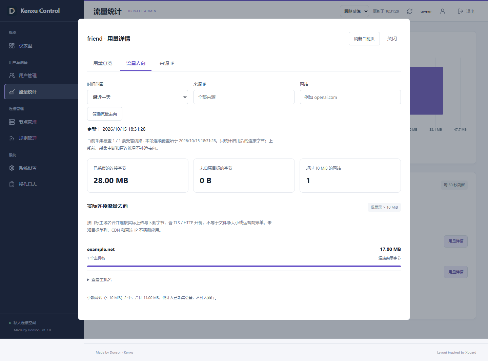

<p align="center"></p>

# Kenxu

面向小范围邀请用户的自托管订阅与流量管理门户。

管理员集中维护线路、分配账号与权限；用户登录后领取自己的配置，查看用量和连接状态。Kenxu 使用 Node.js 与 SQLite，当前部署运行在 Jetson 上，通过 Cloudflare Tunnel 提供 HTTPS 访问，管理后台经私有 SSH 转发访问。

当前代码版本 **1.9.0** · [本轮复核](docs/review-portal-v1.9.0.md) · [交互契约](CONTEXT.md#交互组件契约2026-10-23) · [上一版发布复核](docs/review-portal-v1.8.11.md) · [个人策略组选项](docs/review-portal-v1.8.6.md) · [连接指南重构](docs/review-portal-v1.8.5.md) · [版本发布](https://github.com/DonsonHH/kenxu/releases) · [使用指南](docs/user-guide.md) · [部署与维护](docs/operations.md) · [问题反馈](https://github.com/DonsonHH/kenxu/issues)

1.8.8 按 [Radix Primitives](https://www.radix-ui.com/primitives/docs/overview/accessibility) 与 [WAI APG 页签规范](https://www.w3.org/WAI/ARIA/apg/patterns/tabs/)完善现有原生界面，不引入整站 React 迁移或新运行时依赖：侧栏使用可前进／后退的页面链接，教程采用自动激活页签，用量详情采用手动激活页签；支持方向键、Home／End、焦点恢复和就近重试。两端密码表单提供显示／隐藏，失败刷新保留同条件的已有数据。`node --run test:a11y` 使用虚构账号和临时数据库验证真实交互，不连接生产账号或节点。

## 界面预览

1.8.9 修复登录页密码标签与输入框的异常留白，并统一页头／内容／页脚的高度分配；保留密码可见性和键盘交互，支持低高度桌面与手机自然滚动。`node --run test:login-layout` 覆盖两端、深浅色及 320–2560px 视口的字段对齐和页脚布局。

1.8.10 修复另一服务商的 US3 主线路分类：用户端、管理端和响应图表均按 US1／US2／US3 排序，节点名称、身份和授权保持原样。区域分类不会把带有美国国旗的备用或住宅线路自动归入普通主线路。

1.8.11 区分住宅 IPv6 与英国转发的展示类型，修正节点卡片、账号授权和用量详情里的线路说明；计量身份、实际出站和订阅授权保持原样。

1.9.0 增加登录后的站点公告，支持按账号、公告版本保存“24 小时内不再弹出”，并可从右上角铃铛重新查看。公告通过现有认证响应交付，不额外轮询；首次改密前、管理端及未获相关线路授权的账号不弹出线路通知。

1.4.0 增加用户端本地矢量装饰、静态渐变与轻量过渡，两端支持 2K／4K 居中布局。布局按 CSS 视口和系统缩放自适应，不按物理分辨率盲目放大文字。键盘、减少动态效果及手机深色布局有独立回归。


支持浅色、深色和跟随系统，适配桌面与手机。以下门户截图使用虚构测试账号和用量。

| 用户工作台 | 私有管理后台 |
| --- | --- |
|  |  |

## 提供哪些功能

| 用户端 | 管理端 |
| --- | --- |
| 专属订阅，Clash Verge／Android／Shadowrocket／Stash 导入，下载 YAML | 创建账号、授权线路、重置密码与停用账号 |
| 今日／本月／累计用量，最近 30 天仅列有用量日期 | 按用户和逻辑线路查看上传、下载与历史记录 |
| 用量趋势、线路占比、连接检测结果 | 全站图表、线路用量排行、服务器资源监测 |
| 初始密码修改、订阅链接重置、使用指南 | 用户资料、展示额度、可选有效期、站点设置与操作日志 |
| 按个人方案领取分流规则，进程通配符兼容导出 | 全局／逐用户规则编辑、授权校验、预览与冲突保护 |
| 个人中心只在最近使用 IP 后显示国家／省市归属估算 | 统一“用量详情”：原账本、连接实际字节去向、来源 IP 分页加载；去向只列 > 10 MiB 网站 |
| AI 官方当前状态、功能项、30 天事件／采样与筛选 | AI 状态后台统一采集，不修改节点或用户计量 |
| 登录后查看线路公告、24 小时免提醒、随时重新打开 | 公告文案与版本随代码维护，线路权限仍由授权控制 |

受管线路为每位用户分配独立的 Xray 凭据。即使两个逻辑出口共用一个采集器，也分别记录用量。第三方线路可通过 Jetson 网关转发并计量，用户收到的是网关凭据。

管理员也可通过受控迁移把既有第三方线路改为直连、不计量，并隐藏用户端的节点和历史卡片。迁移保留原授权、订阅链接和旧计量记录；不会将一般停用线路自动切换为共享凭据。直连参数必须交付给获授权的客户端，界面隐藏不等于凭据保密。

默认展示额度为 **100 GB／月**，用于显示本月使用比例，不实施流量限额或限速。管理员可以修改展示额度；账号停用和有效期属于独立的访问权限设置。项目面向邀请制共享，目前没有公开注册、支付、订单或自动售卖功能。

## 工作方式

门户负责账号、配置分发和用量记录。实际代理连接由 Xray 节点或中转网关处理，线路管理需要配套的采集器。

| 组件 | 职责 |
| --- | --- |
| 用户入口 `127.0.0.1:4450` | 登录、订阅、个人用量与节点状态；通过 Tunnel 发布 |
| 管理入口 `127.0.0.1:4451` | 账号、授权、配置和运维；通过 SSH 转发访问 |
| SQLite 私有数据目录 | 账号、会话、用量、设置、审计与认证限流记录 |
| Xray 采集器 | 同步受管用户凭据，上报累计计数；门户处理重复报告和核心重启 |
| Jetson 连接检测服务 | 定时通过源节点访问检测网站，保存时间、状态与响应耗时 |
| 可选监测适配器 | 从允许的监测站读取 CPU、内存、磁盘、网络与运行时间 |
| AI 状态采集 | 门户后台每 5 分钟读取四家官方公开状态源，持久缓存供所有用户共享 |

默认网页查询周期是 60 秒，订阅更新建议为 720 分钟，连接检测周期为 15 分钟。采集器默认每 15 秒采样，具体上报还受队列和网络影响。

1.6.0 的连接分类统计需要[固定核心与配套采集器](https://github.com/DonsonHH/my-ansible-playbooks/blob/master/docs/kenxu-flow-rollout.md)。只有完成隔离校准和试点的线路才启用；页面显示实时采集覆盖数及连续覆盖起点。分类含 TLS／HTTP 开销，不等于文件大小或运营商账单；旧记录不补造网站去向，未计量直连不在覆盖内。它与原总账独立，绝不重复累加。

## 本地运行

需要 Git、**Node.js ≥ 22.13** 和 pnpm。前端资源由 esbuild 构建，服务端直接运行 JavaScript 模块；SQLite 使用 Node.js 内置模块，无需另装数据库服务。

```sh
git clone https://github.com/DonsonHH/kenxu.git
cd kenxu
pnpm install --frozen-lockfile
pnpm build
```

将 [`.env.example`](.env.example) 复制为 `.env`。Linux／macOS 可用 `cp .env.example .env`，PowerShell 可用 `Copy-Item .env.example .env`。默认配置适合本机验证，数据目录为 `./data`。

在交互终端创建管理员，密码输入不会回显：

```sh
pnpm admin create-admin owner
pnpm admin import /absolute/path/to/private-source.yaml
pnpm start
```

将示例路径替换为自己的 YAML 文件路径。已有管理员时，初始化命令会拒绝覆盖其密码。

服务启动后：

1. 打开 [本机管理入口](http://127.0.0.1:4451)，用刚创建的管理员登录。
2. 创建普通用户并分配线路。
3. 用户打开 [本机用户入口](http://127.0.0.1:4450)，先修改初始密码，再领取订阅。

这几步可以运行门户和配置分发。要获得逐用户流量统计，还需部署采集器并注册受管节点，详见[部署与维护](docs/operations.md)。仅导入 YAML 不会自动完成服务器侧计量接入。

## 配置

| 变量 | 开发默认值 | 说明 |
| --- | --- | --- |
| `NODE_ENV` | `development` | 正式部署设为 `production` |
| `DATA_DIR` | `./data` | 正式部署使用公有资源目录之外的绝对路径 |
| `PUBLIC_ORIGIN` | `http://127.0.0.1:4450` | 用户入口的完整 origin，正式部署使用准确的 HTTPS 域名 |
| `ADMIN_ORIGIN` | `http://127.0.0.1:4451` | 浏览器实际访问的私有管理 origin |
| `PORT` / `ADMIN_PORT` | `4450` / `4451` | 两个服务均绑定回环地址 |
| `MONITOR_ALLOWED_ORIGINS` | 未配置 | 可选监测源的 HTTPS origin 允许列表，逗号分隔 |
| `GEOIP_DB` | 未配置 | 私有离线 MMDB 路径；未配置时来源地区显示未知，不上传 IP 查询 |
| `IPINFO_TOKEN` | 未配置 | 可选 IPinfo Legacy Free 服务端令牌；仅查询已观察公网来源，成功缓存 7 天，个人中心只在最近 IP 缓存缺失时补查 |
| `AI_STATUS_PROXY` | 未配置 | 仅供 AI 状态采集使用的既有回环 HTTP 代理；只接受 `127.0.0.1`／`::1`，不修改客户端或分流 |

站点名称、密码最短长度、会话时长、展示额度和查询周期等选项，可在管理后台的“系统设置”中修改。监测源同时需要填写后台网址并加入服务器允许列表。

正式部署使用现有 Cloudflare Tunnel，将公开域名指向用户端口；管理端保留私有访问。仓库的 [`deploy/`](deploy/) 提供针对当前 Jetson 部署的 systemd 示例，使用前应替换账号、路径、域名和二进制位置。配置步骤、Windows 桌面入口及备份方法见[运维文档](docs/operations.md)。

## 分流规则管理

私有管理后台的“规则管理”可直接编辑全局规则，或选择普通用户分配个人方案；用户管理中也提供“配置规则”入口。

| 方案 | 匹配顺序 | 后续全局规则修改 |
| --- | --- | --- |
| 继承 | 使用全局规则 | 跟随更新 |
| 优先补充 | 个人规则在前，全局规则在后 | 继续继承全局部分 |
| 独立 | 使用个人完整列表与保存的兜底策略 | 不跟随规则内容更新 |

节点授权始终独立生效。个人规则不能指定未授权策略，授权变化后导出仍会过滤节点并拒绝未授权目标。独立方案依然共享源节点、策略组定义及规则提供器，不是另一套节点配置。

规则编辑支持常用域名、网段、进程与 RULE-SET／MATCH 类型，限制为单行逗号格式。保存前可以预览实际导出顺序；“复制当前导出规则为独立草稿”便于从已有方案开始调整。格式、授权、兜底位置和修订版本由服务端检查；语法错误和编辑冲突不会覆盖旧配置。当前编辑器不支持 AND／OR／NOT／SUB-RULE 等嵌套语法，匹配内容不能包含逗号。规则提供器通过私有 YAML 源维护。

进程路径／名称通配符在导出时转换为兼容的正则写法，保留顺序和目标，避免旧内核因不认识 `PROCESS-*-WILDCARD` 拒绝整份订阅。转换已通过 Mihomo 1.18.10 与 1.19.32 的真实解析器检查；客户端仍建议使用官方维护版本。保存规则不更换用户凭据、不重置用量、不重启代理核心，用户需要更新自己的远程订阅。


详细操作与格式限制见[规则管理文档](docs/operations.md#分流规则与个人分配)。

Windows 上同时使用 Cockpit 账号代理与 Clash 时，可按个人方案添加[专属引擎直连例外](examples/cockpit-windows-direct.rules.txt)，避免专属 Mihomo 的出站再次被外层接管。不要把所有 `mihomo.exe`、`codex.exe` 或 AI 域名统一改为直连；该例外不适用于手动把 Clash 端口设为上游的情况，也不会取消内部所选节点的正常计量。部署边界和隔离验证见[本次复核](docs/review-cockpit-proxy-20261017.md)。

1.8.6 可通过私有维护 CLI，为指定用户的现有 `select` 组追加已授权、可交付的节点选项；不改全站组成员、默认选择、授权或凭据。撤销授权后，保存的选项不能重新交付该节点。本次 hdc 已撤回上段的可选引擎直连规则，仅给 `AI Policy` 追加现有 JP 选项；其他账号和其他组没有新增 JP。

## 用量与连接状态

用户流量明细只显示最近 30 天实际有上传或下载的日期，按新到旧排列，无记录时显示空状态；趋势图保留完整 30 天时间轴，原账本和统计接口不删零日期。



1.7.0 将“查看明细”和“使用日志”合并为一个“用量详情”弹窗，分为用量总览、流量去向、来源 IP。总览使用原生计量账本；网站去向仅使用连接实际字节，彻底移除旧关联区间算法、切换入口和原始关联明细接口。尚无分类数据时显示暂无，不拿旧账本推算网站用量。

按注册主域名合并后，上传＋下载**严格大于 10 MiB**（10 × 1024² 字节）的网站进入前十排行。小额网站只从排行隐藏，仍保留计量并展示小额合计；未知目标字节单列。分类不重复添加到原账本，不补造启用前的历史去向。`co.uk` 等公共后缀和独立托管租户不会误并。

管理员保留来源详情与主动归属查询；用户端删去历史来源栏目，只在最近使用 IP 后显示国家、省／州与城市估算，不显示运营商或 ASN。进入个人中心时读取这一条记录；若尚无归属缓存，会通过受保护请求补查该 IP，成功缓存 7 天，失败退避 5 分钟。后台只使用已配置的 **Legacy Free** 凭据，不发送账号或访问目标，不猜测具体住址、不调用付费接口。读取 GET 接口本身不触发外查，令牌不返回浏览器。旧版本记录保留在历史 review 文档中，不代表当前界面。

- 用量按受管入口的上传与下载合计，月视图采用北京时间自然月；每月重算月视图，累计记录保留。
- Clash Verge 通过订阅响应头读取本月用量；它的卡片通常在更新订阅时才刷新。导入本地 YAML 文件不会自动获取这些响应头。
- 网页的“正常”表示 Jetson 最近一次通过源节点成功访问了检测网站。个人网络和公开中转入口可能有不同结果，客户端测试仍有参考价值。
- 用户端只统计当前可领取的线路，未完成个人接入或已停用的受管入口不计入可用节点；授权变动会随网页查询同步，不要求用户退出再登录。管理端仍能检查全部源节点。
- 失效线路可以通过私有 CLI 安全退役：移除配置和授权，保留历史计量，不更换用户订阅链接。共用采集器的其余线路继续运行；客户端须更新远程订阅才能清除本机缓存中的旧节点。
- 新检测将 HTTP 响应与连接准备、全程耗时分开：响应数字是开始 HTTP 传输到首字节的时间，不包括 DNS／代理／TLS 建链，也不是 ICMP ping。用户卡片和图表只显示 HTTP 响应，旧全程数据或失效检测不冒充新口径；管理端仍可展开细则。用户点阵显示最近最多 24 次实际检测、次数、左旧右新与颜色图例，不是全天可用率。
- 直连、旧共享凭据或绕过受管入口的连接，无法归入某位用户。核心突然退出时，最后尚未上报的字节可能丢失。
- 监测站中的主机网络数据与用户代理用量口径不同，界面分开展示。
- 管理端“用户管理／流量统计 → 用量详情”是同一入口。总览中的每日和线路合计来自原账本；流量去向来自连接分类，各自读取，不做分钟区间与目标的关联推算。
- 使用元数据保留 30 天，清理不影响长期用量合计。管理端来源页列最近十个来源，可选 1／7／30 天；用户个人中心只展示本人最近使用 IP 及归属，不展示历史列表、目标或管理日志。未计量直连入口不覆盖。不记录 URL 路径、请求正文或进行 TLS 解密。
- 两端节点分为 SG 主节点、US 主节点和其他线路。用户隐藏的备用仍隐藏；China@US 明确为直连未计量。卡片国旗使用本地 SVG，图表与表格使用 `[US]` 等文本标识，配置中的原始名称和规则引用不变。
- 用户连接响应图与卡片保持同一顺序：SG1／SG2／SG3、US1／US2、其他。宽屏六张卡片尽量同排，窄屏自动换行，不对数值或检测口径做修改。

电脑、Android、iPhone／iPad 的安装、导入和连接步骤见[用户使用指南](docs/user-guide.md)。订阅页会按设备建议客户端，也可以手动选择。一键导入直接把个人订阅交给已安装的应用，不经过第三方转换网站。Clash Verge 与 Clash Meta 使用原始 YAML；Stash 使用适配的 iOS YAML；Shadowrocket 使用授权 VLESS 节点订阅，不包含 Clash 策略组和规则。

该指南使用当前 Donson 部署的组名，其他部署可以自行替换。导入协议和输出格式已通过自动检查；应用能否在具体手机上打开与完整连接，仍受系统、浏览器和客户端版本影响，页面同时提供复制链接的手动步骤。

## AI 状态

工作台的“AI 状态”集中展示服务当前状态、功能项与官方事件；自己的连接检测独立位于“节点状态”。来源为 [OpenAI](https://status.openai.com/)（含所给 [RSS](https://status.openai.com/feed.rss)）、[Claude](https://status.claude.com/)（含 [RSS](https://status.claude.com/history.rss)）、[AI Studio／Gemini API](https://aistudio.google.com/status) 和 [Grok／xAI](https://status.x.ai/)（[官方文档注明的 RSS](https://docs.x.ai/developers/debugging)）。Gemini 不以 Workspace 或 Vertex 的状态替代，也不声称覆盖所有个人 Gemini 应用场景。

采集由 Jetson 后台每 5 分钟执行，即使没有访问者也会运行；浏览器只读共享缓存，不逐用户请求官方站点，不调用付费推理接口或携带用户身份。支持功能项、进行中事件、30 天官方事件日历、真实采样明细、服务／阶段／日期筛选，以及本地“查看更多”。1.8.3 将已取得的官方记录未列出事件的日期显示为绿色“未报告异常”，不称为实际采样正常；实际异常、未取得的记录和当天源不可用仍独立处理，采样数据库与原始数组不变，不推算可用率或 SLA。RSS 和官方历史接口可能不完整，官网链接始终保留。

AI 页面不再显示重复刷新、四个“查看记录”按钮和采集时间，默认随网页周期自动回读缓存，仍可通过顶部刷新按钮重试。用户和管理端页脚统一为简短的责任提醒，侧栏版本号保留。

1.8.4 去除节点／AI 页内容区重复标题，订阅入口统一为“一键导入”，放大安装与手动导入说明；个人资料卡在宽屏居中并对齐字段，长 IPv6 与地区自然换行。四家状态标志改为[本地 SVG](docs/provider-marks.md)，不向访客浏览器引入外站取图；两端页脚以小型盾形提醒栏融入页面。

1.8.2 修正 OpenAI 兼容 summary 合法省略 `incidents` 导致的误判：仅对 OpenAI 使用经过验证的官方事件列表交叉核对；请求失败或数据无效仍标未知，不默认为空列表。Claude 的当前列表和所有事件时间、RSS 安全校验保持严格。浏览器读取失败时撤销卡片的当前正常结论并保留历史，首次读取失败也能明确重试。页面去除重复解释和节点对照，不影响节点或用量。

AI Studio 暂无承诺稳定的公共状态 API，适配器仅匿名读取官方状态页使用的只读模块；页内公开客户端标识只在服务器内存中短期复用，不是用户 Google 登录或私有 Gemini API 密钥。结构或枚举不认识时拒绝猜测，显示源暂不可用。部署、缓存与回退见[运维说明](docs/operations.md#ai-官方状态采集)。

## 开发与验证

1.8.5 根据新入门文档和当前订阅界面重写[连接指南](docs/user-guide.md)。电脑、Android、iPhone / iPad 分别按安装、个人订阅导入、选线路和实际访问验证排列；使用当前两个主要策略组的示例图，区分 Shadowrocket 节点订阅与 Stash iOS YAML，不发布共享订阅、二维码或第三方账号。下载入口指向客户端官方稳定版／商店，教程不修改节点或分流配置。

```sh
pnpm build
pnpm test
pnpm exec playwright install chromium
pnpm test:browser
pnpm audit --prod
```

浏览器检查使用临时数据库和虚构账号，截图写入被 Git 忽略的 `test-output/`。已有 Edge 或 Chrome 时，可将 `PLAYWRIGHT_CHANNEL` 设为 `msedge` 或 `chrome`。例如 PowerShell：

```powershell
$env:PLAYWRIGHT_CHANNEL = 'msedge'
pnpm test:browser
```

刷新行为的复现脚本为 `node test/refresh-performance.mjs`。源码修改后运行 `pnpm build`，再提交相应构建资源。当前检查涵盖账号与权限隔离、认证限流、订阅元数据、月边界、流量去重、删除账号后的旧计数、主题与移动端交互。

登录来源兼容性检查为 `node test/browser-origin.mjs`，已纳入浏览器测试。默认使用 Chromium；设置 `PLAYWRIGHT_BROWSER=firefox` 或 `webkit` 可单独复测相应引擎，需要先安装对应的 Playwright 浏览器。测试同时覆盖真实登录页面、首次改密引导、私有管理端，以及错误来源与 CSRF 的拒绝行为。

规则编辑流程由 `test/browser-rules.mjs` 验证，包含用户切换、失败恢复与迟到响应隔离。可用 `node test/rules-core.mjs /absolute/path/to/mihomo` 额外运行真实内核检查；该检查仅使用虚构配置。私有源的子集检查脚本接受第三个地理数据资源目录参数，避免把缺少 GeoIP 数据的环境故障误判为规则失败；不要将真实配置或诊断原文提交到仓库。

线路退役的页面统计由 `test/browser-retirement.mjs` 验证，覆盖共享采集器登记入口退役、最后一条共享线路退役、当前线路／采集器数量与历史用量保留。运行概况只统计启用线路；历史用量和排行保留退役线路产生的实际记录。

```text
src/          服务端、数据存储、计量、连接检测与前端构建入口
public/       页面、可编辑样式、浏览器模块与构建产物
scripts/      构建和连接检测脚本
deploy/       服务单元与私有管理入口示例
test/         后端、浏览器和刷新性能检查
docs/         用户指南、部署维护、版本 review 与界面截图
```

## 安全与维护

用户端与管理端校验不同角色，使用 HttpOnly／SameSite 会话、Origin 与 CSRF 校验。公开入口在显示登录表单前将普通 HTTP 访问跳转至 HTTPS，敏感 HTTP 请求直接拒绝；只有配置为受信任的回环 Tunnel 接收头会用于识别访客协议。登录限流持久化到数据库，包含账号、来源及总量限制，并约束密码计算并发。当前版本没有 TOTP／WebAuthn。

订阅链接是访问凭据。不要将密码、链接、私有 YAML、SQLite 数据、节点密钥或真实用户截图提交到仓库，也不要对订阅／采集接口启用共享缓存或交互式浏览器验证。静态资源使用校验缓存，敏感响应保留 `no-store`。

升级前备份完整私有数据目录，保留可回退的发布目录。复制数据库前需要停止门户和连接检测等写入者；详细方法与账号删除注意事项见[部署与维护](docs/operations.md)。

## 反馈与贡献

欢迎通过 [Issues](https://github.com/DonsonHH/kenxu/issues) 提交问题和改进建议。描述版本、复现步骤、预期与实际结果，截图及日志请先移除账号凭据。涉及安全问题时，请先联系维护者确认私下报告方式。

提交代码前运行相关检查；界面修改请附桌面和手机效果，协议或计量修改请说明数据兼容性。项目 review 记录见 [1.0.0](docs/release-v1.0.0.md)、[1.1.0](docs/review-v1.1.0.md)、[文档校对](docs/review-docs-20261002.md)、[移动端适配](docs/review-mobile-v1.2.0.md)、[教程交互优化](docs/review-guide-v1.2.1.md)、[登录入口安全](docs/review-login-v1.2.2.md)、[规则兼容／个人分配](docs/review-rules-v1.3.0.md)、[大屏／检测口径／体验](docs/review-experience-v1.4.0.md)、[节点状态范围复核](docs/review-scope-v1.4.1.md)、[线路退役](docs/review-retirement-v1.4.2.md) 和[退役后运行统计复核](docs/review-active-counts-v1.4.3.md)。

## 致谢与许可

界面信息架构参考 [cedar2025/Xboard](https://github.com/cedar2025/Xboard)，门户使用独立的 Node.js／SQLite 实现。节点部署与采集器相关工作位于 [DonsonHH/my-ansible-playbooks](https://github.com/DonsonHH/my-ansible-playbooks)。项目使用 React、Sonner、Lucide、Chart.js、Express、yaml 和 esbuild。

由 [DonsonHH](https://github.com/DonsonHH) 维护，采用 [MIT License](LICENSE)。第三方库许可见 [THIRD_PARTY_NOTICES.txt](THIRD_PARTY_NOTICES.txt)。离线 GeoIP 读取使用 maxmind／mmdb-lib；地理数据库需自行提供，仓库不分发真实使用日志或地区库。
