# 1.7.0：实际流量、个人来源与管理流程复核

日期：2026-10-15。初始基线：Kenxu `1c9c165`、Ansible `2acd6ed`；两端与 GitHub 默认分支一致，初始工作区干净。

## 先复核上一步

五台 Azure 的现场检查均核对原生／观察累计计数、核心 SHA-256、私有观察 socket、回环 API 和服务状态。SG2 的 SG／UK 身份仍独立；正常上传中的短暂原生队列经严格检查排空，分类队列没有积压。核心仍为上一轮已验收二进制，本轮没有替换或重启 Xray。此前 56 项门户测试通过。

发现的问题：旧页面仍可退回历史关联口径；相同用户有“查看明细”和“使用日志”两个弹窗；配置源维护混在系统设置中；未注册的 China 备用只显示笼统的未计量状态；国旗依赖 Windows emoji 字体。走查又发现深色按钮对比度、取消后密码字段残留和失败筛选保留旧结果的问题，本轮一并修正。

## 五项逐步复核

1. **实际连接流量去向 — 本地通过。** 删除旧 `groupActivity` 算法和原始关联日志接口，页面不再提供口径切换。网站按注册主域名合并后，上传＋下载严格大于 10 MiB 才列入前十排行；等于阈值也隐藏。小额合计和未知目标分开，原始字节、总账和重试幂等不变。边界、跨子域名合并、筛选和重复上报有回归；没有分类时不会回退推算。
2. **自己的来源详情 — 本地通过。** 用户个人中心只读本人近 30 天来源，支持 1／7／30 天和省市／运营商缓存；仅主动点击时外查。接口由会话决定用户，传入其他用户 ID 不会扩大范围；他人来源／私网／未观察 IP、无会话和 CSRF 错误有拒绝测试。公共查询独立限流，目标仍只限管理员。
3. **一个用户详情 — 本地通过。** 用户管理和流量统计统一调用同一“用量详情”，总览、去向、来源 IP 三个页签分别按需加载。再次切换不重复请求；失败时隐藏旧筛选结果并可重试；关闭、退出和切换用户清理私有内容。页签支持方向键／Home／End，原生日志堆叠列表已删除。
4. **管理端全站走查 — 本地通过。** 下面逐页记录职责与截图。配置源维护归到节点管理，规则快捷入口只进入已有规则编辑器。密码取消时清空、重置明确显示目标账号，弹窗具备可访问名称。保持单一 Sonner 容器，弹窗内状态就地显示，深色按钮与零用量坐标刻度修复。
5. **节点分组与国旗 — 本地通过。** 两端分为 SG 主节点、US 主节点、其他线路。当前管理端 3／2／3，用户端只显示有权领取且未隐藏的 3／2／1。China@US 为隐藏直连未计量，不创建伪计量记录；JP 的旧记录保留。国旗采用本地 SVG，图表／表格使用国家代码；配置名称、规则引用、授权和实际导出不受显示变化影响。

## 管理流程逐页审计

以下截图均在本轮隔离 Edge 中捕获并逐张检查，账号、地址、用量、地区和资源读数都是测试夹具，不是生产日志。没有使用个人浏览器登录状态。测试除当前七页外也覆盖原有登录、建号、首次改密、停用、订阅撤销、规则保存和冲突拒绝。

### 1. 仪表盘 — 通过

全站摘要和趋势；“管理用户／查看节点”只跳转对应页，不新增编辑表单。零用量保留明确空状态，不伪造流量。

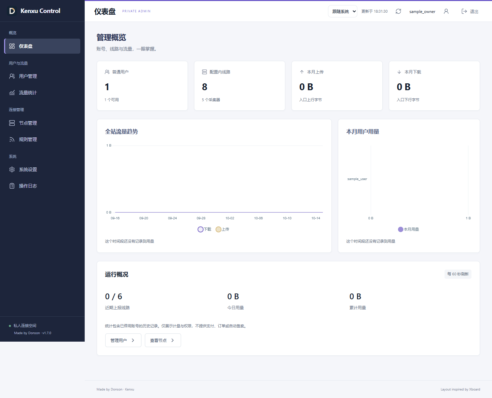

### 2. 用户管理 — 已修正并通过

建号、资料／权限、规则快捷入口、唯一用量详情和重置密码。编辑与重置弹窗显示目标账号；取消不提交，敏感字段会清空。规则入口复用规则页，不另建第二份规则管理。

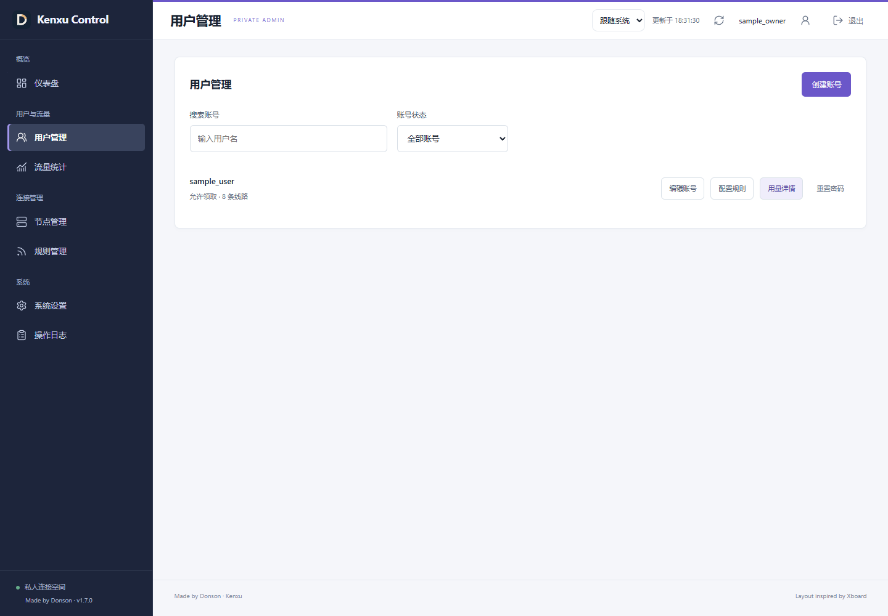

### 3. 流量统计 — 已合并并通过

全站图表与按用户搜索；每行只有一个“用量详情”。总览读原账本，去向读实际字节，来源独立读来源观察，不再做账本分钟与域名的关联推算。节点用量是另一种“按节点看用户”的范围，不与用户弹窗混用。

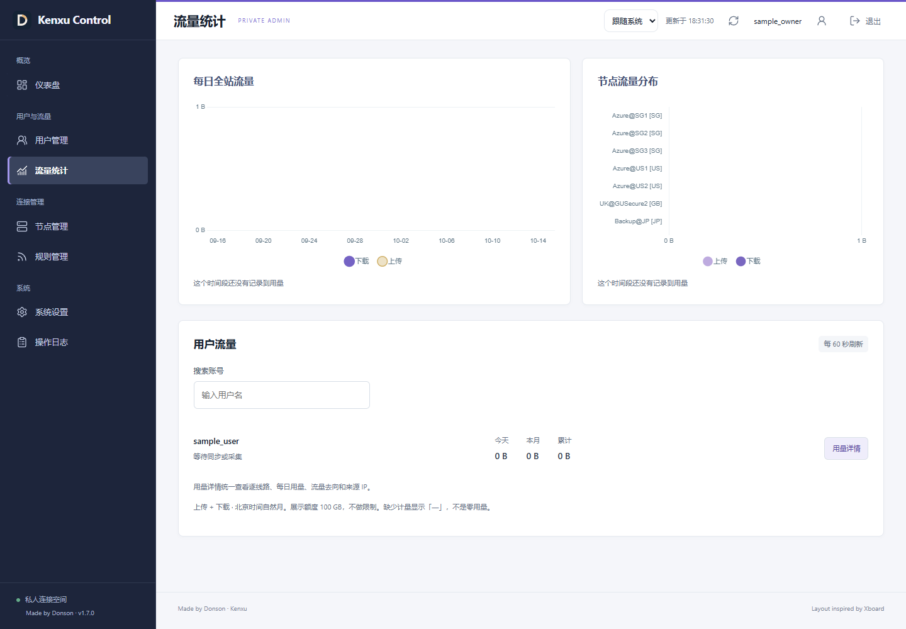

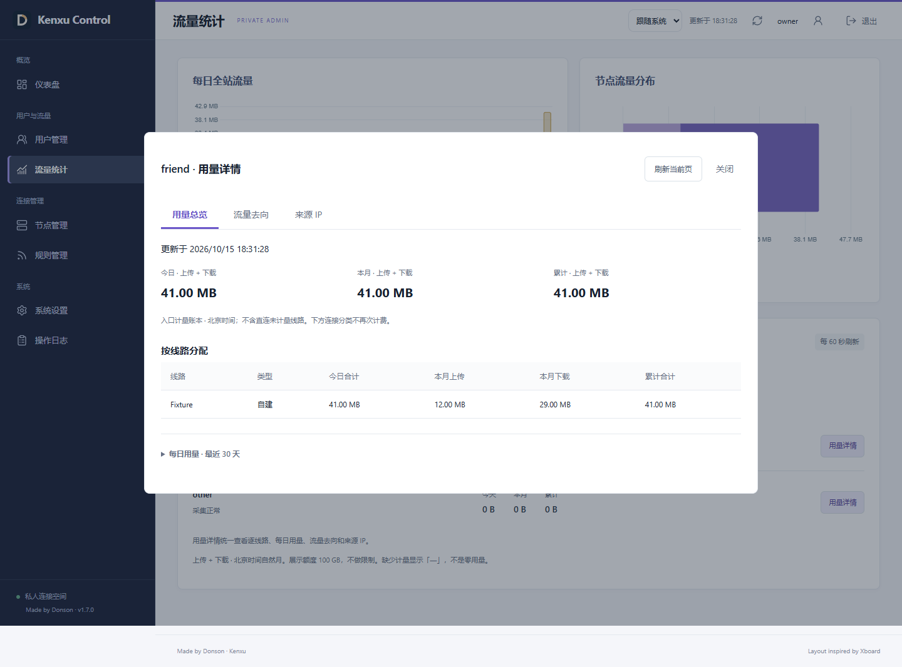

### 4. 节点管理 — 已整理并通过

出口检测、服务器资源、节点用量分别标注；SG、US 和其他分组。直连未计量不会显示为采集离线，未注册的 China 不提供伪用量详情。高级配置源上传统一在这里并默认折叠；无效文件拒绝后导出保持不变。

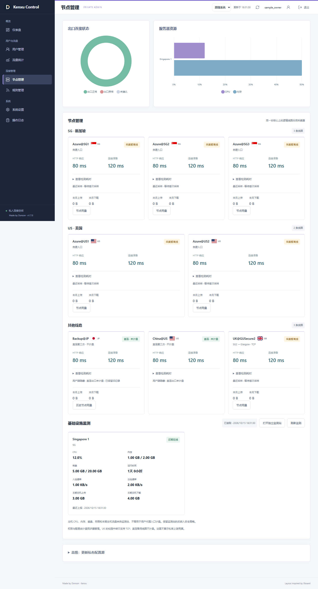

### 5. 规则管理 — 通过

唯一的全局／个人规则编辑器，保留预览和修订冲突保护。预览和选择器用可显示的国家代码；实际编辑内容、提交值和导出仍保留原名称，不能把展示名称当成配置引用复制。

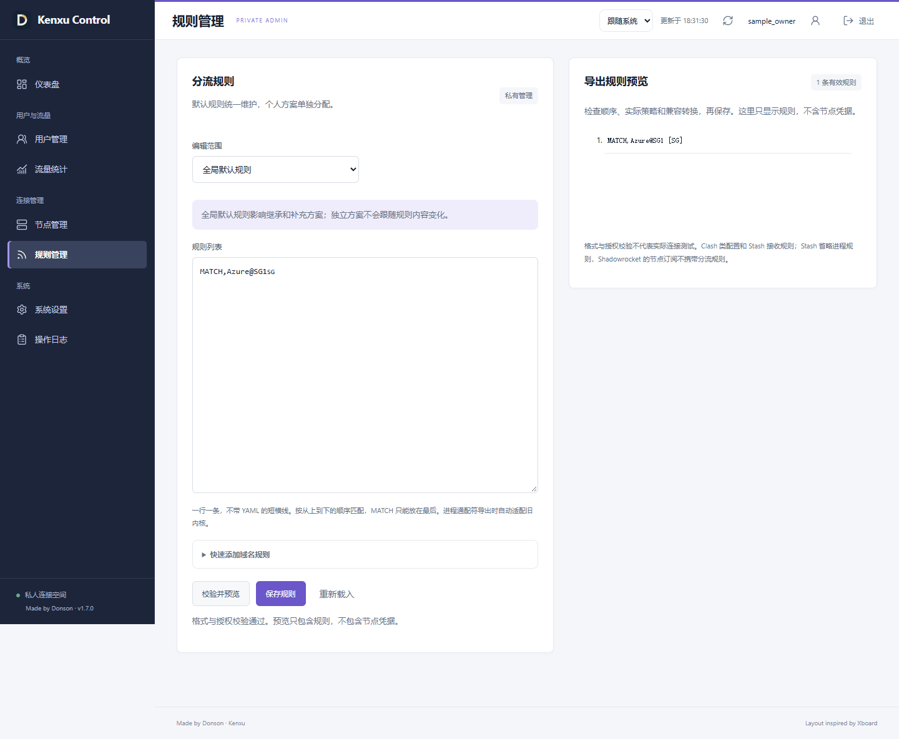

### 6. 系统设置 — 已收敛并通过

只负责站点名称、周期、展示额度、密码和会话策略等持久设置；源配置维护已移出。设置校验和修改回读仍有回归，不在监测页重复提供同一表单。

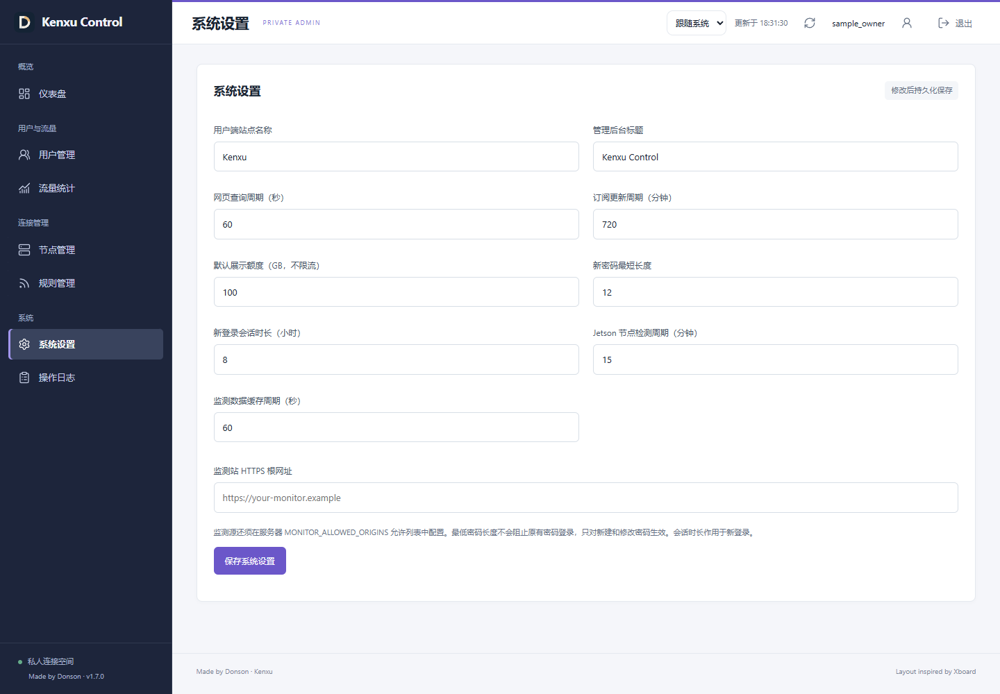

### 7. 操作日志 — 通过

只记录管理行为，不复制用户代理明细。默认近 24 小时、每页 30 条，查看更多扩至 30 天；超期自动清理和稳定分页有独立测试。

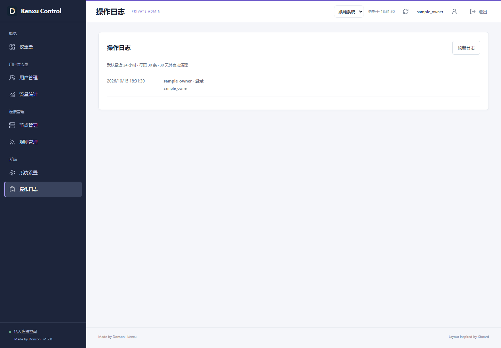

## 用户侧与可访问性

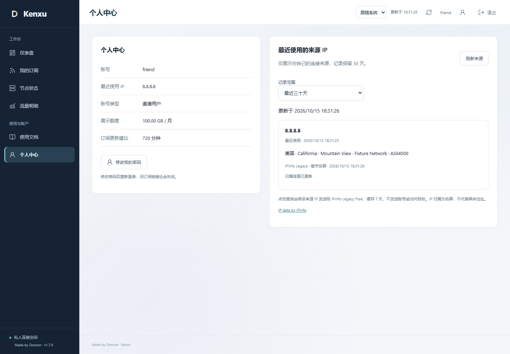

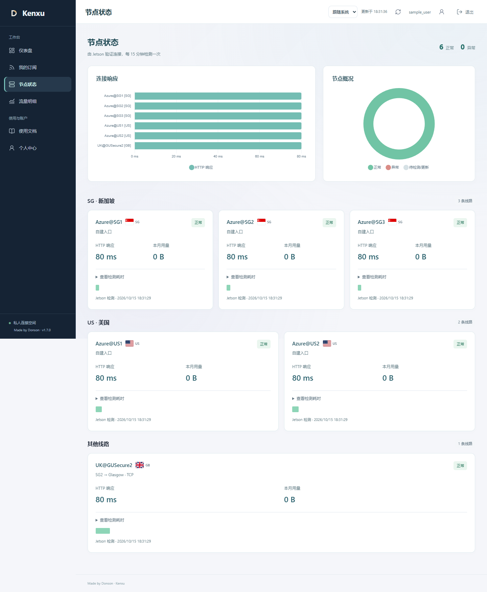

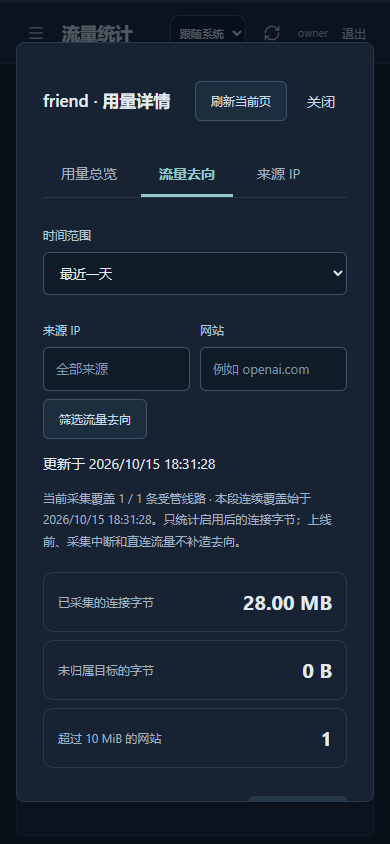

验证了 390／1280／1920／2560／3840 CSS 像素视口、浅／深色、键盘页签、Escape 关闭、焦点返回、减少动态效果和横向溢出。截图不能证明完整 WCAG 合规；没有宣称真实读屏器、所有手机内核或真实手机导入都验收通过。省市也不是精确定位。

## 代码职责与回归

`flows` 只处理连接字节；`activity` 保留来源观察和保留期，不再关联旧账本。来源卡片由两端共用一个模块，用户／节点总览复用一个表格模块；展示分组与身份保持独立。三个详情页分别请求，不打开来源页就不聚合来源，不打开去向页就不查询网站。

- 58 项 Node 测试、25 项 Python 采集器测试通过。
- 9 个隔离 Edge 浏览器脚本通过，包含本轮新增全管理流程审计；构建与生产依赖审计通过。
- GitHub 两仓库默认分支与初始本地基线一致。没有 Actions 运行记录，不宣称 CI 通过。
- 国旗来自 [flag-icons](https://github.com/lipis/flag-icons)，固定提交 `086f7e97d657358203916dbe84f61c2bccaa81eb`，完整 MIT 许可随资源保留。没有运行时 CDN 或新图标依赖。

## 上线后复核

已发布到 Jetson 1.7.0，公开 HTTPS `/healthz` 回读相同版本，Cloudflare 的脚本响应为 `private, no-cache`／BYPASS。仅短暂重启门户，节点和 Tunnel 不重启；原发布目录保留，回退只切代码，不恢复旧数据库覆盖新用量。

- 6 位可用账号的 Clash／Stash／Shadowrocket 共 18 份实际订阅响应体 SHA-256 与上线前一致。
- 账号、凭据、授权、个人规则、站点设置、订阅密钥及原总账旧记录哈希不变；另行比对分类表既有字节行哈希不变。新用量继续追加，没有按新筛选删除历史字节。
- 5 个采集器心跳新鲜、无分类积压和交付缺号；6 位用户均为 6／6 逻辑线路覆盖。UK 仍独立，JP／China 不计入受管覆盖。
- 真实用户会话读取自己的来源；管理目标接口在公开用户端拒绝访问，旧关联明细接口在管理端返回 404。验证用的短期诊断会话全部删除，未注销或替换既有用户会话。
- 管理节点分组 3／2／3，用户可见分组 3／2／1；China 隐藏且标为直连未计量。脚本、CSS、HTML、图表和四个 SVG 的线上文件哈希与本地一致。
- 当前数据下，18 次本机回环分类查询的最大响应约 143 ms，6 次个人来源查询最大约 64 ms；这是一次验收样本，不是 p95、外网延迟或长期性能承诺。
- 一致性数据库备份权限受限，已去除 IP／目标标签；线上数据库没有做此脱敏清空。门户、连接检测和 Tunnel 三项服务均正常运行。

边界不变：未启用前和采集缺口不补造网站；直连备用不计量；突发断电可能损失尚未落盘的窗口，不承诺任意故障零丢失。
