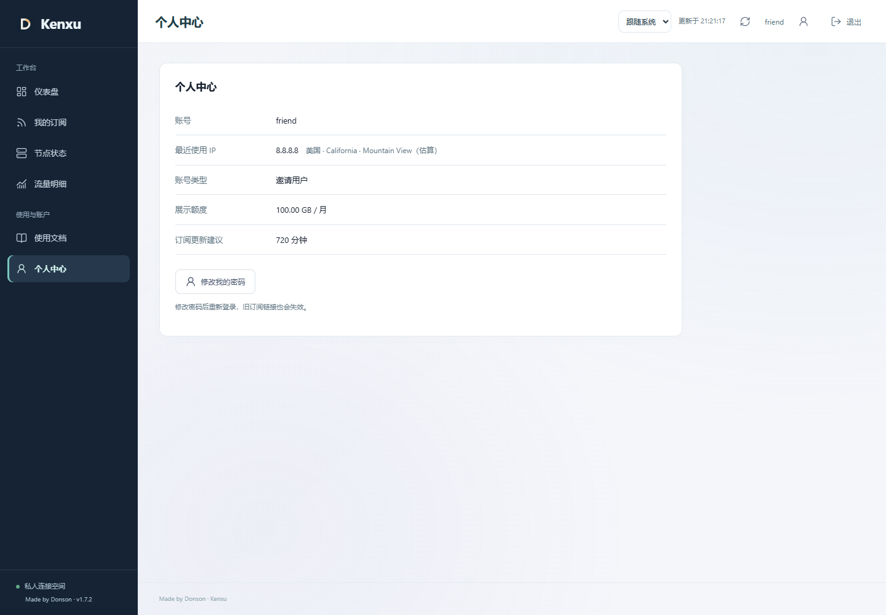
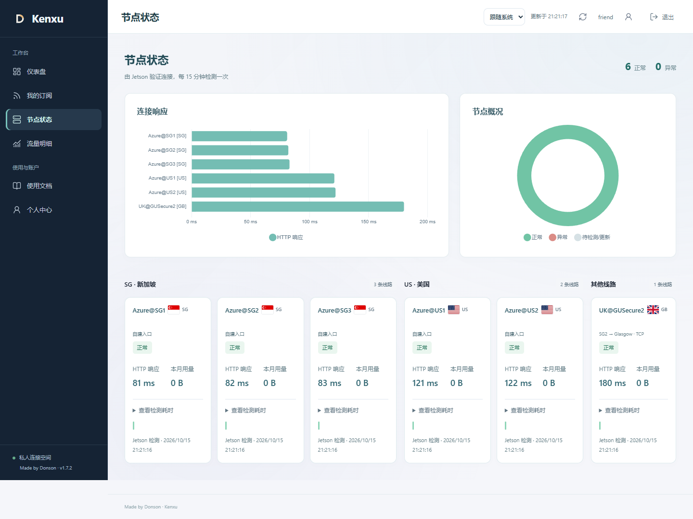
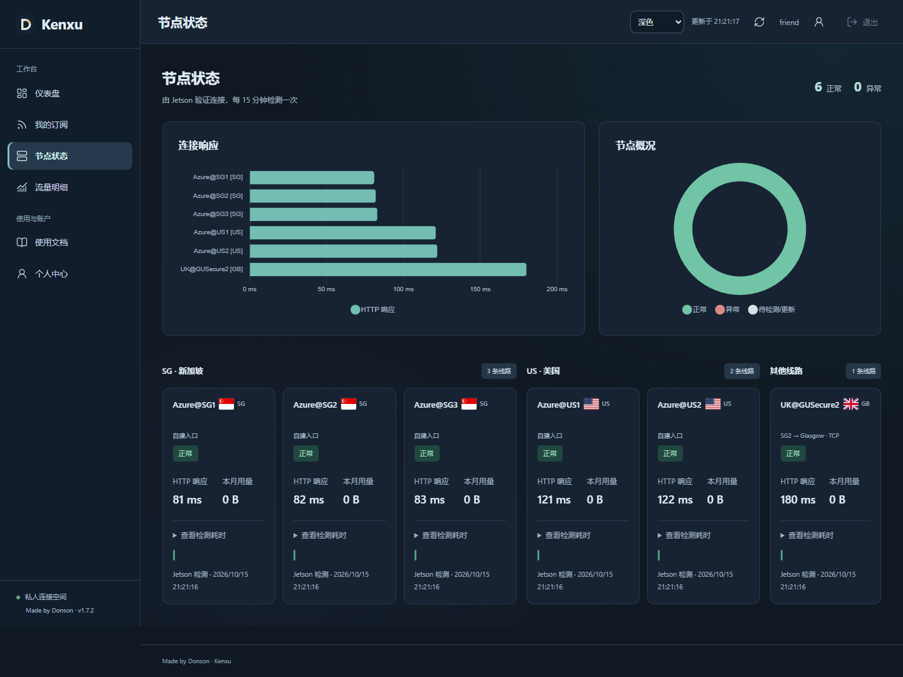
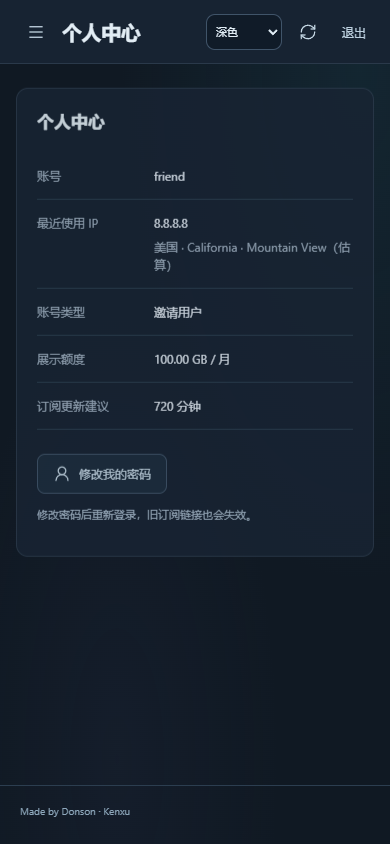

# 1.7.2：精简用户端个人中心与节点布局

日期：2026-10-15。门户起点 `61b1f75`，初始工作区干净且与 GitHub 默认分支一致。范围仅为本次提出的三个用户端调整，不改节点、订阅分流、授权或计量。

## 界面调整与逐项复核

| Before | After | Why |
| --- | --- | --- |
| 个人中心左右两栏，右侧是完整来源列表、筛选与查询按钮 | 删除右栏；只在“最近使用 IP”后显示国家、省市归属估算 | 用户只需要最近这一条，不需要重复的历史管理界面 |
| 响应图沿用后端返回顺序，与下面分组不一致 | 与卡片共用排序：SG1、SG2、SG3、US1、US2、其他 | 从图表到卡片保持相同阅读顺序，且不改变检测数值 |
| SG／US／其他分别纵向堆叠，占用多行 | 宽屏六张同排，仍保留分组；较窄视口按三列或可读宽度换行 | 减少纵向滚动，不把手机卡片强挤成一排 |

个人中心一张卡片，地址与 IP 位于同一字段；不显示 ISP／ASN、历史记录、筛选器或额外查询按钮。地址标为“估算”，不声称能定位精确住址。窄屏长地址可自然换行。

响应图使用刻意乱序的源配置验证，前三项仍为 SG1／SG2／SG3。测试给每个节点分配不同延迟（81、82、83、121、122、180 ms），校验排序后的名称和数字逐项对应，未按延迟重新分配标签。只排序用户图表，不改接口顺序或管理端资源图。

1440、1920、2560、3840 CSS 像素下，实际读取六张卡片边界确认同排；1280 和 768 使用可读的分行布局，390 自动单列。已检查浅／深色及横向溢出；UK 长名称与其他卡片高度对齐。受限账号只有一条 US 线路时，不会制造 SG 卡片或无权节点。

## 数据与性能范围

- 新增 `GET /api/account/last-use`，由已认证会话确定用户，只读取最近一个来源及已缓存国家、省市；不读取整个来源列表，不返回其他用户、访问目标、ISP／ASN、凭据或令牌。GET 本身不联系外部提供方。
- 进入个人中心，若这一条公网 IP 还没有归属缓存，前端通过既有 Origin／CSRF 保护的 POST 补查该 IP。沿用服务端 7 天缓存、5 分钟失败退避、并发与用户限流；没有批量查历史 IP。旧的本人来源列表接口为兼容保留，但新界面不调用。
- 查询失败时保留已知离线地区，缺少省市不补造。迟到请求、退出、切换账号和 401 仍受生命周期保护，不能将旧地址显示在新账号中。
- 管理端详细来源、来源筛选、运营商查询和流量去向保持不变。自动补查的可见范围说明已同步到使用文档、FAQ 和运维说明。
- SG／US 排序只使用网页展示模型；配置原始节点名称、ID、分流引用和每个用户的实际订阅不变。没有改 Xray、采集器、原账本或分类计数算法。

## 验证与最终 review

新增本人最近 IP 接口集成测试：先观察到 404 失败，再实现通过；检查外部查询只发生在受保护 POST、缓存命中不重复查询、传入他人 ID 不扩大读取范围、无记录返回空。

新增隔离浏览器场景：用户端只一张个人卡片、不请求历史列表、仅最近 IP 自动补查一次并命中缓存；图表乱序输入正确排序且数值不串线；六张卡片宽屏同排、多视口无横向溢出、手机深色、受限授权和退出后的清空。原来源详情与生命周期脚本适配新界面后继续覆盖管理端和会话失效行为。

本轮 59 项 Node 测试、完整 11 个隔离 Edge 浏览器脚本、构建与生产依赖审计通过。截图均来自这轮隔离测试的虚构账号、IP、地区和延迟，不是生产用户日志。未声称读屏器完全合规或所有手机真机验证通过。

## 上线后复核

已发布到 Jetson `20261015-v1.7.2-portal-reviewed`，公开 HTTPS `/healthz` 回读 1.7.2；用户脚本、图表、CSS 和 HTML 的线上哈希与本地已测文件一致。旧 1.7.1 代码目录保留；只短暂重启门户，不重启 Xray、连接检测或 Tunnel，回退只切代码，不恢复旧数据库覆盖新用量。

现场检查 6 位可用用户的最近一条接口：只返回本人记录及国家、省市，不包含历史列表、ISP／ASN、访问目标或其他账号。没有为验收调用生产 IPinfo 补查；自动补查及缓存行为在隔离提供方中验证。

18 份实际 Clash／Stash／Shadowrocket 订阅响应体、账号／凭据／授权／规则／设置／密钥、原账本与分类历史字节基线均保持不变。五个采集器、六条逻辑线路覆盖与权限隔离检查通过，门户、检测、Tunnel 服务均 active。临时诊断会话结束后删除，不影响既有用户会话。
