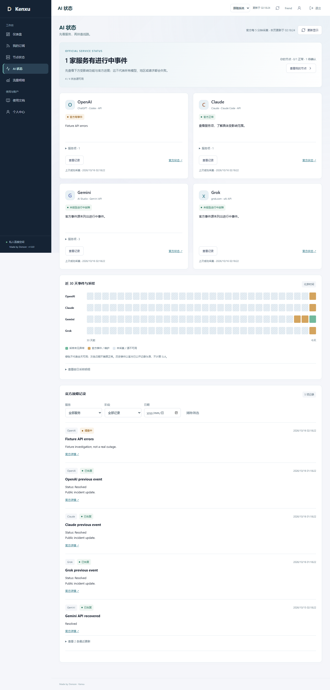
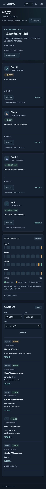

# 1.8.0：AI 官方状态与活跃用量日期

日期：2026-10-16。起点为门户 `0758c9c`（GitHub main）与采集仓库 `a006c66`（GitHub master）；两者工作区干净、与默认分支一致。先重跑旧版本回归和线上数据核对，再实施本轮功能。没有改节点、个人配置、授权、凭据或原生计量口径。

## 界面与口径

| Before | After | Why |
| --- | --- | --- |
| 流量明细表固定列出 30 个日期，包括全零日期 | 只列最近 30 天有上传或下载的日期，倒序排列，并给出活跃天数和空状态 | 减少无内容行；趋势图、接口数组和账本仍保留完整时间轴与字节 |
| AI 网站失败时只能切换节点猜原因 | 工作台新增 AI 状态：官方功能项、进行中事件、30 天记录与节点检测对照 | 把厂商事件和本人连接检测分开，不把官方故障等同所有用户都无法使用 |
| 尚无本地状态采样历史 | 只补入官方仍公开的事件，未观察日期标灰 | 不补造 30 天全绿，不将事件订阅冒充连续成功率或 SLA |
| 厂商数据抓取失败、格式变化可能产生错误结论 | 保留历史，当前标未知；未知阶段及无效事件不能默默变成正常 | 明确区分状态源不可用、AI 服务事件与节点异常 |

页面沿用现有主题和轻量切换反馈，不新增动画库或持续闪烁。宽屏为四列服务卡片，较窄桌面两列，手机单列；记录默认只渲染八项，更多记录和筛选均在本地完成。采样条提供文字说明及可展开的按日表格，不要求用户逐一聚焦 120 个小色块。既有 Sonner 仅用于主动“更新显示”的反馈，后台采集不弹窗，也没有第二个 Toaster。

## 官方来源与范围

- [OpenAI](https://status.openai.com/)：当前 summary、用户指定的 [feed.rss](https://status.openai.com/feed.rss) 和官方历史 JSON。
- [Claude](https://status.claude.com/)：当前 summary、用户指定的 [history.rss](https://status.claude.com/history.rss) 和官方历史 JSON。
- [AI Studio／Gemini API](https://aistudio.google.com/status)：按用户进一步确认，仅覆盖 Gemini API、Multimodal Live API、Google AI Studio，不使用 Workspace／Vertex 替代。官方开发文档的 [Status 入口](https://ai.google.dev/gemini-api/docs) 指向该页面。
- [Grok／xAI](https://status.x.ai/)：使用 [官方文档](https://docs.x.ai/developers/debugging) 指定的 `feed.xml`。没有独立的完整功能项数据时不造服务项；无进行中事件仅表述为“未报告进行中故障”。

Gemini 匿名状态页面使用只读页面模块，而非承诺稳定的公共状态 API。其页面内公开客户端标识只在服务器内存短期复用，不持久化、不返回浏览器，不使用用户的 Google 登录、Cookie 或私有 API 密钥。格式变化须显式适配，不能以另一个 Google 产品的正常状态兜底。本轮真实页面联调发现旧事件存在非 URL 格式标识，以及 Mitigated／Update 阶段；已按公开页面核对并加入回归夹具，不通过关闭验证来掩盖问题。

## 资源、安全与数据边界

后台随门户进程启动，每 5 分钟独立采集。浏览器按需读取认证缓存接口，查询参数不能改变 URL、跳过缓存或要求外查；无需访问者保持在线，不调用付费 AI 推理，不发送用户身份、订阅或用量日志。网络开销属于主机正常出站；若既有代理使用计量账号，其实际转发字节仍按原规则计量，不承诺网络请求“零流量”。

固定 HTTPS 来源禁止跳转，超时 8 秒、单响应最大 512 KiB，XML 拒绝 DTD／外部实体；事件链接限制为对应官方 origin，正文只按文本显示。可选出站代理只允许显式回环 HTTP 地址，不改电脑或节点的分流。失败退避至下一轮，保留上次结果但不继续声称当前正常；超过 15 分钟没有新成功采集也标未知。

采集存入独立 `ai_status_*` 表，不写 `usage_events` 或 `flow_events`。历史按北京时间展示 30 天，已恢复事件按保留期清理；进行中事件可以跨越保留窗口继续展示。RSS 的发布时间、恢复时间与完整历史 JSON 分别处理；没有可靠起点时不补造故障开始时间。进行中事件延续至今天，已采样到的 outage 不被一般事件标记降级。

## 回归与最终 review

本地 68 项 Node 测试通过，完整 12 个隔离 Edge 浏览器脚本通过；AI 新界面额外覆盖 390、768、1280、1440、1920、2560、3840 CSS 像素，无横向溢出。已人工查看桌面与手机深色截图。截图来自临时数据库和虚构事件，不是生产用户、流量或实际厂商故障的截图。

测试包括：全零／上传一字节／仅下载日期、完整图表时间轴、权限与首次改密、缓存和重启持久化、无人访问时定时采集、停止清理、未知阶段、无效／外站 RSS、DTD、源失败与过期、跨日事件、严重程度保留、筛选和分页、真实 401 清空界面。新旧边界问题先复现失败，再修正通过；不是仅运行静态语法检查。

定时验收还复现了一个实际节奏问题：以“上次完成时间＋五分钟”判断缓存，会使固定五分钟计时器因请求耗时而跳过一轮。已将仅供内部计时器使用的采集轮次与普通缓存刷新分开，页面仍无法强制外查；回归夹具注入四秒请求完成延迟，确认下一轮不会漏采，而非只测试瞬时响应。

Ansible 仓库 25 项 Python 测试与默认分支核对通过，无需修改采集或核心代码，因此没有创建空提交。生产依赖审计未发现已知漏洞。两个仓库的既有 Actions 运行记录为空，不把本地通过表述为 GitHub CI 通过。

## 上线验收

最终发布目录为 `20261016-v1.8.0-ai-status-final`。相同代码在 Jetson Node 22.23.2 上再次通过 68 项测试，真实读取四家官方来源；Gemini 三个服务项与官方页面范围一致。复用的回环代理属于 Jetson 自己的 `clash-verge-service`，已启用自启动，不是依赖操作电脑的 SSH 转发。只短暂重启门户，未重启 Xray、节点检测、Tunnel 或修改客户端分流。

没有手动强制外查；保存采集基线后实际等到下一轮后台运行，四个来源的成功时间全部推进，约五分钟周期核对通过。普通缓存读和带 `force`／`url` 参数的请求都不能改变上游采集行为。未登录访问公开 AI 状态接口返回 401；诊断临时会话结束后清理，不替换现有用户登录。返回内容中不包含 Google 页面客户端标识、用户目标或订阅。

18 份实际 Clash／Stash／Shadowrocket 订阅响应体、账号、授权、凭据、规则、设置、订阅密钥、原账本与分类历史字节均与发布基线一致。五个采集器、六条逻辑线路的当前覆盖和权限隔离检查通过。代码回退目录及一致性备份保留；只对备份副本移除来源与目标标签，不修改在线历史，也不以旧数据库覆盖新用量。

公开 HTTPS 仍返回 1.8.0，脚本、图表与样式的边缘响应哈希匹配本地构建。HTML 仅附加原有且已识别的 Cloudflare analytics 脚本；严格移除这一段后与本地逐字一致，仍为 `no-store, private`，未放宽 CSP。门户、检测、Tunnel 和既有代理服务均 active。

这证明当前实现、短时发布与实际定时轮次通过，不是长期 soak、所有终端或厂商内部状态的保证。官方记录可能延迟或不完整；Google 页面内部协议可能改变；没有相关官方事件也不能反证个人节点、账号或地区一定正常。上述边界已在用户界面和运维说明中明确区分。
