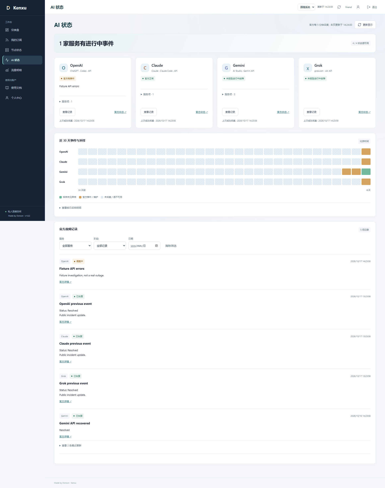
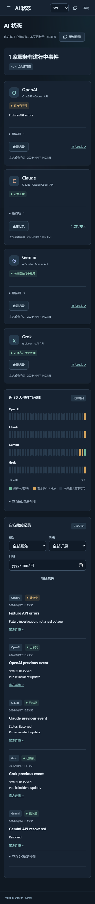

# 1.8.2：OpenAI 状态读取修复与页面精简

日期：2026-10-17。起点为门户 GitHub main `bfaa173` 与采集仓库 master `a006c66`；两个工作区起初干净，与远端一致。本轮先核对上一轮改动、文档、回归与生产数据，再修复截图所示问题，没有修改节点、分流或个人订阅。

## 可复现原因

Jetson 和本机均实际取得 [OpenAI summary](https://status.openai.com/api/v2/summary.json) 的 HTTP 200：返回 `page`、`status`、25 个 `components`，但省略 `incidents`。同一次核对的[官方事件列表](https://status.openai.com/api/v2/incidents.json)正常返回 25 项已恢复事件。旧版把省略字段判为无效来源，在隔离真实源检查中稳定复现 `openai.available=false`；另外三家可读取。它不是本次 Jetson 代理连不上 OpenAI，也不需要更改节点。

修正仅针对 OpenAI 的兼容 summary：省略列表时，必须成功取得并验证官方事件列表，用状态指示、功能项与未关闭事件交叉核对。事件列表此时不再是可有可无的历史附件，不通过 `incidents || []` 掩盖问题。请求失败、畸形记录、缺时间或显式 `incidents: null` 仍标未知并保留历史。进行中事件仍降级，未知阶段不变绿；Claude 仍要求明确的当前列表。RSS 的外站链接、无效条目及 XML 安全校验不放宽。

## 界面复核

| Before | After | Why |
| --- | --- | --- |
| 大段解释状态源与服务故障的区别，重复“绿色不代表全天可用”等说明 | 删去页面长段说明、英文眉题和重复副标题；保留状态标签、图例、时间与官网入口 | 用户先看到结论，详细口径留在运维文档；不靠重复小字解释整个页面 |
| AI 页重复展示“你的节点 · 6/6 正常”和“查看我的节点” | 完整移除区域、状态更新钩子与样式；节点页保持原样 | AI 官方事件和个人连接检测各归其位，不留空容器或无效调用 |
| 正常／未知卡片重复“查看服务项”“保留上次状态”等模板句 | 只在有可确认的进行中事件时显示实际事件标题 | 减少无信息文字；故障源与门户读取失败仍有不同的简短状态标签 |
| 首次读取门户失败，标题永久停在“正在读取官方状态” | 显示“门户状态读取失败”，保留可用的重试按钮 | 这是本轮隔离浏览器复核中另行确认的错误反馈问题，不把失败显示成加载中 |

卡片空白占位高度已删除，概要压缩为状态标题和来源计数，手机自动换行。保留现有主题、轻量反馈与单一 Sonner 实例，没有新增动画库或后台弹窗。灰色历史、可访问的图形摘要及可展开按日表格仍保留；删除屏幕说明并不把未知日期改为正常，也不产生 SLA／成功率估计。

以下截图来自隔离数据库、虚构账号与事件，不是生产用户或真实厂商故障：

## 测试与双仓库检查

- 用实际响应的字段结构建立回归：旧实现先得到 `available=false` 的失败，再修正通过。补测进行中／未知阶段、官方事件列表 503、缺列表、无效时间、显式 null、保留历史，以及 Claude 不继承 OpenAI 的例外。
- 浏览器先复现多余区域仍存在，以及首次 503 后标题停留加载；再验证移除、正常卡片无模板句、故障标题保留、历史筛选和展开、503 后恢复、真实 401 清空及重试。
- 本地完整 **73 项 Node 测试**、**12 个隔离 Edge 浏览器脚本**通过，涵盖用户／管理员、权限、订阅、用量、规则、过期会话、深色及 390–3840 CSS 像素布局。人工查看桌面和手机截图。生产依赖审计未发现已知漏洞。
- Jetson 新目录用 Node 22.23.2 重跑 73 项测试通过；独立临时数据库读取四家真实官方源均成功，包括 OpenAI 25 个功能项及官方历史／RSS 合并后的 42 项近期事件。
- 采集仓库 **25 项 Python 测试**通过，复查固定核心、部署保护和计量口径文档，未发现本轮需改动的内容，保留 `a006c66`，不制造空提交。本轮没有重做 US2 隔离校准，也不把旧校准记录当作今天重新执行的证据。
- GitHub 两仓库元数据、默认分支与最新提交均已鲜读核对。两个仓库 Actions 的公开运行列表仍为空，不声称 GitHub CI 通过。

## 发布与数据边界

已原子发布到 Jetson `20261017-v1.8.2-openai-status`，只短暂重启门户。新进程在没有页面外查的情况下成功采集四家官方来源；五个采集器补报正常，六条逻辑线路覆盖完整，原节点检测、Tunnel 与既有代理服务保持 active。保留旧 1.8.1 目录、0600 一致性账本备份与代码回退路径；备份副本去除来源／目标标签，不删在线数据，不用旧数据库覆盖新用量。

发布前后核对 **18 份实际 Clash／Stash／Shadowrocket 订阅响应**、账号、授权、凭据、规则、计量注册和密钥保持一致。原账本、已有连接分类字节及发布前已结束的 AI 采样桶哈希一致；过去“未知”采样没有补成绿色。临时诊断会话均使用独立短期令牌并清理，没有更换真实用户会话。

公网 HTTPS `/healthz` 回读 1.8.2，AI 状态接口未登录仍为 401。客户端、样式、图表、通知与图标文件哈希与本地相同；HTML 精确去除唯一且原已存在的 Cloudflare analytics 脚本后与本地一致，仍为 `no-store, private`，未放宽 CSP。公网页面与构建产物不再含被删除的节点对照和长段说明，使用指南同步改为左侧“节点状态”入口。

已只读等待后续约五分钟后台轮次：四家 `last_success` 均从 14:26 推进至 14:31，OpenAI 持续可读，未通过手动刷新上游替代定时验收。再次读取认证接口正常，原有历史采样与字节核对仍一致。

最终复查未发现本轮范围内尚未处理的回归。此处是短时功能验收，不能保证官方内部协议今后不变化，也不是所有网络、模型和账号的可用性证明。
