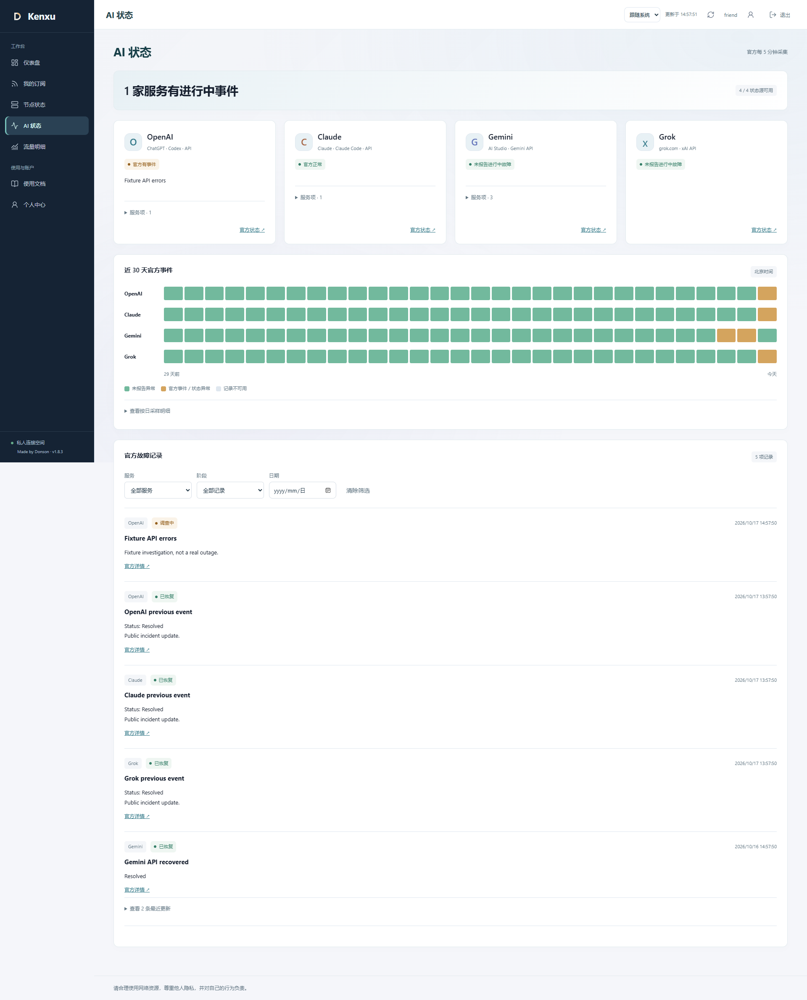
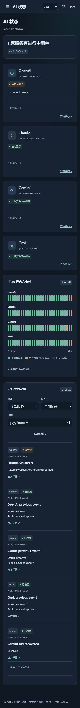

# 1.8.3：官方事件日历与精简展示

日期：2026-10-17。起点为门户 GitHub main `f2fe44f` 和采集仓库 master `a006c66`；两者本地干净、与默认分支一致。先复核上一轮修复、GitHub 当前提交、文档与线上状态，再进行本轮展示调整。

## 上一轮复核

OpenAI 读取修复仍有效，线上四家来源可读，OpenAI 的 25 个功能项和近期合并事件可用。发布前再次核对 18 份实际订阅、账号／授权／凭据／规则／密钥、历史用量及连接分类字节，均与 1.8.2 基线一致。五个采集器、六条逻辑线路覆盖正常，原有状态采样没有补造。两仓库 GitHub Actions 运行列表仍为空，不把本地测试描述成 GitHub CI 通过。

本轮没有发现需要更改采集器、核心或分流的问题，Ansible 保留 `a006c66`，不创建空提交；也未重新部署 VPS 或重做历史隔离校准。

## 界面与数据含义

| Before | After | Why |
| --- | --- | --- |
| AI 页显示“本页更新于…”和独立“更新显示”，与顶部刷新重复 | 只保留五分钟后台采集周期；随页面自动更新，主动重试使用顶部刷新 | 减少操作和时间戳，不影响缓存读取、重试或后台采集 |
| 四张卡片各有“查看记录”和“上次成功采集” | 移除按钮、时间戳及其事件处理／样式，保留官方入口与实际进行中事件 | 页面已有下方统一筛选记录，无需四个重复入口 |
| 图表把未曾本地采样的历史日期标灰 | 默认改为“近 30 天官方事件”，已取得记录没有列出事件的日期显示绿色“未报告异常” | 满足按官方事件阅读的需求，但不能把没有采样的日期称为“采样未见异常” |
| 可能将所有未知都直接改绿 | 实际异常和官方事件优先保留；从未读取、成功记录之后的日期、当天来源不可用或未知仍灰色 | 来源故障不能伪装服务正常，保留真实降级含义 |
| 底部为 Made by Donson · Kenxu／布局参考文字 | 两端和登录页统一为“请合理使用网络资源，尊重他人隐私，并对自己的行为负责。” | 原创责任提醒，不伪造名人引语，不声称它能产生法律免责效力 |

日历是独立的纯前端派生视图，不改 `ai_status_*` 数据库、接口的原始 `history`、采样次数或用量账本。展开的“按日采样明细”仍显示实际记录，未采样保留未知。绿色图例、悬停提示和可访问摘要均使用“未报告异常”，不说实际全天正常，不计算 SLA。官方 JSON／RSS 有分页和保留范围，已经取得的事件不等于完整故障全集；不依照“官方一定列全所有故障”的假设回填数据。

当天来源失败或门户读取失败时，当前卡片仍降为未知，保留历史。顶部主动刷新错误会传递给现有操作反馈，不再错误地提示“数据已更新”；后台读取失败只更新页面状态，不触发后台弹窗或未处理的 Promise 拒绝。菜单切换、失效会话、旧身份迟到响应的隔离保持不变。

图表仍为四行各 30 格，起始日期标签修正为“29 天前”；真实采样日期和北京时间口径不变。移除时间戳后卡片自适应，保留现有深浅主题和轻量切换，不新增动画依赖。页面底部提醒字号与行距保证手机可读；侧栏署名／版本仍保留，README 的项目来源致谢未移除。

## 验证

- 用新增纯模块公开接口验证事件视图：先复现旧视图不能产生所需“未报告异常”状态，再通过正常无事件、原始数组冻结不变、实际异常优先、来源失败、未曾读取、未来日期与北京时间午夜测试。
- 浏览器先确认旧页仍有 9 个被要求移除的元素，再修正；验证无重复按钮／时间戳、统一筛选、官方链接、事件标题和真实采样记录不变。
- 双端导航、登录页和手机布局验证责任提醒；模拟时钟确认 AI 页仍随 60 秒周期回读一次共享缓存，无新增上游请求。顶部刷新遇到 503 明确报错、不弹成功，后续重试恢复；真实 401 清空敏感界面。
- 本地完整 **76 项 Node 测试**、**12 个隔离 Edge 浏览器脚本**通过；覆盖用户和管理员既有功能、390–3840 CSS 像素、浅色与深色。已人工查看下方隔离截图。前端重复构建的五个生成资源哈希一致，生产依赖审计未发现已知漏洞。
- Ansible 的 **25 项 Python 测试**通过，代码和部署保护未改。Jetson 新发布目录用 Node 22.23.2 重跑 76 项测试通过，临时数据库读取四家真实官方源成功。

截图仅使用虚构账号和测试事件，不是实际厂商故障或生产用户数据：

## 发布后验收

已原子发布到 Jetson `20261017-v1.8.3-event-calendar`，保留 1.8.2 目录、0600 一致性账本备份和代码回退路径。只短暂重启门户，不重启 Xray、节点检测、Tunnel 或既有代理。新进程四家来源均读取成功，五个采集器补报正常、六条逻辑线路完整覆盖。

发布前后 **18 份真实 Clash／Stash／Shadowrocket 配置响应**以及账号、授权、凭据、规则、密钥与计量注册哈希一致；原账本、连接分类历史字节和发布前已结束的采样桶一致。前端日历生成前后原始数组也保持一致；没有把过去未知采样改为正常，没有新增外查接口。临时验证会话均已清理，不替换真实用户会话。

公网 `/healthz` 回读 1.8.3，未登录的 AI 接口仍为 401；脚本、样式、图表、图标、通知及两个 AI 源模块哈希与本地一致。HTML 精确去除唯一且原已存在的 Cloudflare analytics 脚本后与本地一致，仍为 `no-store, private`，未放宽 CSP。公网页面不含被移除的 AI 刷新、时间戳或旧页脚。

已只读等待后续五分钟轮次：四家来源均从 15:00 的成功记录推进至 15:05，OpenAI 持续读取正常；没有手动外查替代定时验证。再次核对认证接口和历史字节／采样不变，最终 review 未发现本轮范围内未处理的回归。

本文不把短时结果当作长期服务保证，官方记录仍可能不完整或延迟。
