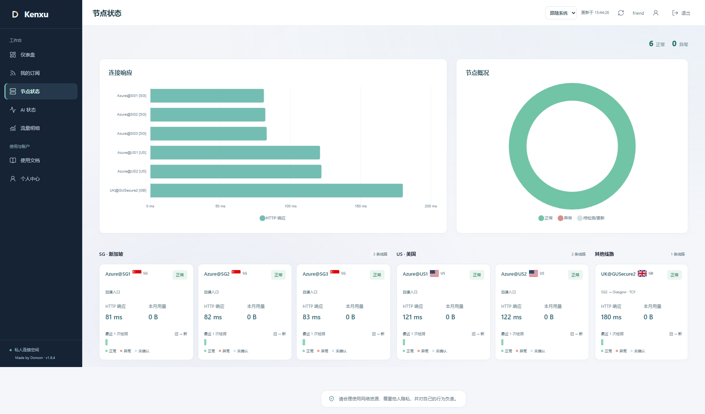
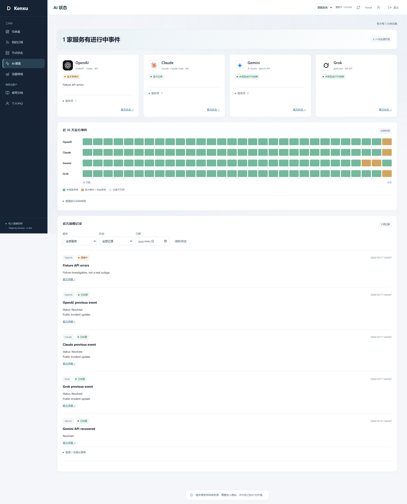
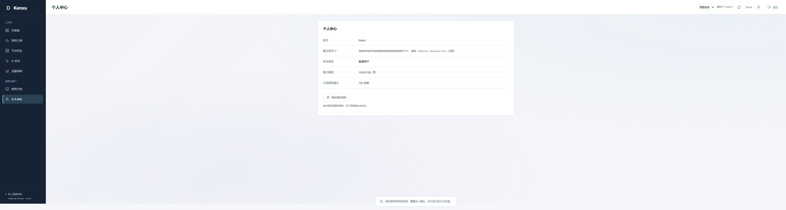
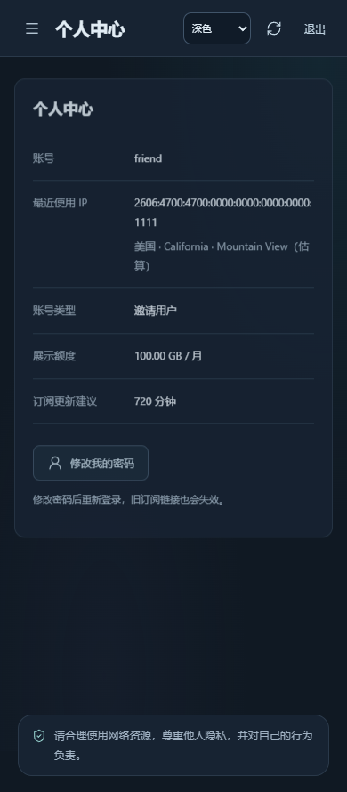

# 1.8.4：用户端信息层级与宽屏资料对齐

日期：2026-10-17。起点为门户 GitHub main `280516f` 和采集仓库 master `a006c66`，两个本地工作区初始干净且与远端一致。先复核上一步及线上数据，再进行本轮用户界面调整；没有改节点、分流、授权、凭据、用量口径或后台检测周期。

## 上一步与双仓库复核

1.8.3 的四家官方来源均可读，原有 18 份实际订阅、账号／规则／授权／密钥、历史用量和连接分类字节与发布基线一致；已结束的 AI 采样桶也未改写。五个采集器和六条受管逻辑线路覆盖正常。两个 GitHub 默认分支和最新提交已鲜读核对，Actions 运行列表仍为空，不声称 GitHub CI 通过。

门户改动前的 76 项 Node 测试及 Ansible 的 25 项 Python 测试通过。Ansible 代码、固定核心和部署保护本轮未发现需要修改的问题，保留 `a006c66`，不制造空提交，也不将过去的节点校准描述为今天重做的校准。

## 发现、实现与界面 review

| Before | After | Why |
| --- | --- | --- |
| 普通 YAML 提示重复安装与连接步骤，按钮叫“导入” | 隐藏普通 YAML 模板句，所有订阅客户端统一“一键导入”，保留简短设备格式区别；安装／手动导入说明增至 14px、行高 1.85 | 聚焦实际操作，同时不把 Shadowrocket 节点订阅误说成完整 Clash 分流 |
| 节点页和 AI 页的内容标题与顶部标题重复 | 保留顶部页面名称，删除内容区重复标题；节点概况保留正常／异常计数 | 减少重复层级，不删除真正的图表标题 |
| 用户卡片有 Jetson 周期、检测时间及准备／全程长段细则 | 卡片和图表只显示 HTTP 响应，详细准备／全程信息仅在管理端保留 | 用户只看需要的响应，运维仍能排查建链与传输差异 |
| 旧全程记录可能在无新样本时继续作为响应显示 | 卡片、图表共用 `httpResponseMs`，只接受正常的 `http-response-v2` 有限非负数字；其他显示未知 | 不把旧全程、失效检测、字符串或 NaN 冒充 HTTP 响应；合法 0 ms 保留 |
| 点阵没有可见的次数、方向和图例 | 标明最近实际检测次数、左旧右新、正常／异常／未确认；逐格时间提示和图形文字摘要保留 | 每格是一次真实检测，不是一天，也不是连续可用率；不补造点阵 |
| 点阵与图例在浅色下的绿色略有差异 | 浅色／深色按实际点阵配色统一图例 | 视觉含义精确对应，避免同一状态两种颜色 |
| 四家状态标志是首字母 | 换为本地 SVG，保留服务文字与可访问名称，不让浏览器向第三方取图 | 识别更直接，四份图形合计约 8 KiB，无新增运行时图标依赖 |
| 3840 视口中资料卡贴左：2520px 面板、850px 卡片，左右空白 0／1670px | 资料卡最大 960px 居中，左右空白均为 780px；字段改为稳定网格列，长 IPv6 和地区可换行 | 已用可失败的浏览器几何断言复现并修正主要布局问题，避免高宽度下内容偏置 |
| 责任提醒直接贴在页脚，视觉突兀 | 改为居中盾形图标、柔和边框与主题底色的小型提醒栏 | 采用用户允许的美化方案，保留原意，不杜撰名人引语或免责效力 |

响应仍是 Jetson 经源节点的 HTTP 传输到首字节时长，不是访问者的本机 ping。没有改写数据库的 `latency`、`setupMs`、`totalMs` 或历史样本。实际 0 ms 也不再被图表空状态当成“无数据”；失败／未知不取最小值或使用除数美化。

个人中心的主要复现是卡片没有自动左右边距，而非先假定浏览器缩放错误。修复后另测长 IPv6 与地区字段，在 390、768、1280、1920、2560、3840 宽度下验证居中、值列对齐和无溢出。仍只读本人最近来源、按需查询一条 IP，不新增来源历史或第三方隐私数据。

标志来源和完整许可见[资源说明](provider-marks.md)。OpenAI 使用官方 Agents 仓库图形，Claude 使用官方 favicon，Gemini 使用 Google 产品 SVG；Grok 官方资源在本次环境返回 403，使用可审查的 LobeHub MIT SVG，不声称已下载官方包。图形不拉伸或重绘，只用于服务识别，不表示厂商背书。SVG 已检查无脚本、事件属性、foreignObject、DTD 或外部资源。

## 验证

- 宽屏资料卡断言先失败，确认左右空白 0／1670，再验证 780／780；长 IPv6 和地区通过实际账号接口夹具驱动，非只改 DOM 文本。
- 先复现用户节点仍有重复标题／耗时细则和图例配色不一致，再分别修正通过；原有响应式测试更新为用户无细则、管理端仍可展开全程明细，不把被要求删除的功能继续当验收条件。
- 新增响应读数回归覆盖新口径、旧全程、未知口径、失效状态、字符串、负值、NaN、Infinity、零值。浏览器再次写入旧口径夹具，确认卡片为“—”、图表为未知，后台原始旧记录保持旧口径。
- 四个客户端按钮、URI 和授权配置仍正确；普通 YAML 提示隐藏，说明字号达到 14px。四个本地 SVG 均实际加载并解码，AI 页无重复标题，当前状态降级／筛选／过期清理仍通过。
- 本地完整 **77 项 Node 测试**及 **12 个隔离 Edge 浏览器脚本**通过，涵盖用户／管理员、390–3840、浅深主题、键盘、减少动态效果、账号切换和过期会话。生产依赖审计未发现已知漏洞；没有新增依赖或动画库。Ansible **25 项 Python 测试**通过。

以下截图仅含虚构测试账号、地址、用量和事件：

## 线上验收

已原子发布到 Jetson `20261017-v1.8.4-user-polish`，保留旧 1.8.3 目录、0600 一致性备份和代码回退路径。新目录用 Node 22.23.2 重跑 77 项测试，四家真实官方源均可读；只短暂重启门户，没有重启 Xray、节点检测、Tunnel 或既有代理，也没有修改服务环境。

发布后 18 份实际 Clash／Stash／Shadowrocket 配置响应与发布前哈希一致，账号、授权、凭据、全局／个人规则、计量注册和密钥一致；原账本、连接分类历史字节及已结束的 AI 采样桶也一致。五个采集器补报正常、六条受管逻辑线路覆盖完整，临时验证会话已清理，没有替换真实登录。

公网 `/healthz` 回读 1.8.4，AI 接口未登录仍为 401。客户端、样式、图表、节点显示模块、AI 模块及四个 SVG 的哈希与本地一致；HTML 精确去除唯一且原有的 Cloudflare analytics 脚本后与本地一致，仍为 `no-store, private`，未放宽 CSP。后台原始准备／全程字段保留，前端响应值按同一公开模块校验。

已只读等待下一轮：四家成功采集时间均从 15:48 推进至 15:53，未手动刷新上游替代后台轮次。再次读取认证接口正常，历史字节／采样核对一致，最终 review 未发现本轮范围内未处理的回归。

测试或截图不证明所有客户端／网络均正常，短时验收不是长期服务保证。
