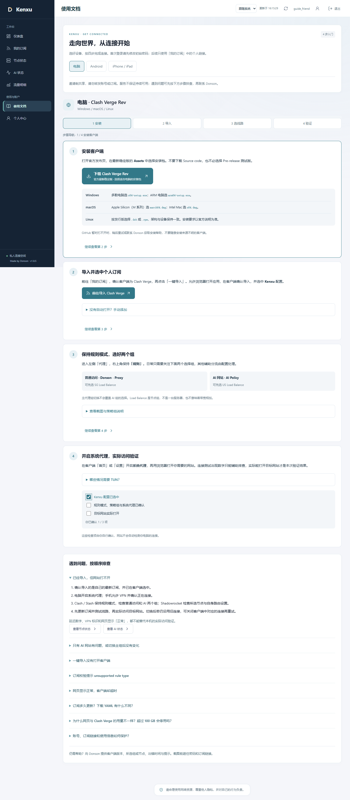
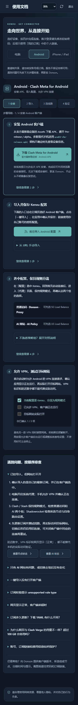
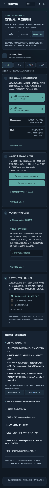

# 1.8.5：按当前配置重构连接指南

日期：2026-10-17。门户起点为 GitHub main `b8a9dc1`，采集仓库 master 为 `a006c66`。两处初始工作区干净，Git remote 和 GitHub API 的默认分支提交一致。按用户确认，本轮只重构连接教程，不加入回国、网盘、影音或其他 AI 服务介绍。

## 上一步与双仓库复核

先重跑门户 77 项 Node 测试与采集仓库 25 项 Python 测试。线上 1.8.4 四家官方 AI 来源可读，六条受管逻辑线路／五个物理采集器状态及权限边界正常；实际 18 份 Clash、Stash、Shadowrocket 配置、账号、授权、规则、凭据、密钥、原用量与历史分类字节和发布基线一致。已结束的 AI 采样也未被改写。

发现教程仍指示用户操作已隐藏的组，并在旧图表中解释了已退役的住宅线路。旧截图虽仍可作为历史证据保留，却不适合当作当前操作指引。修复仅落在门户的教程、配图与对应样式／测试，没有修改采集或 Xray 代码；Ansible 保持 `a006c66`，不制造空提交。两个仓库的 Actions 运行列表均为 0，不声称 GitHub CI 已通过，也没有把此前隔离校准描述成本轮重新校准。

## 来源与内容取舍

完整阅读并渲染核对用户提供的 11 页新 PDF。只提取连接教程，并与当前个人订阅、用户新截图和客户端官方说明交叉检查：

- 公共下载／安装帮助改为官方稳定版和商店入口，不复用来源中的共享订阅、二维码、私有下载镜像、密码或其他服务截图。
- Android 更新间隔采用本站默认建议的 **720 分钟**，不沿用来源的 1440 分钟，不修改后台设置。客户端已有设置或管理员日后变更以实际为准。
- 分清 Apple Silicon 与 Intel Mac、Windows x64 与 ARM，Linux 按发行版／架构选择，不把所有 Mac 都描述为 ARM。
- iOS 使用自己的 Apple 账号，地区、价格与系统要求以商店为准；不建议借用陌生账号。设备验证仅由用户在系统提示中确认。
- Shadowrocket 是节点订阅，使用应用自身路由；Stash 为已适配的 iOS YAML，不将两者都说成完整桌面配置。
- 将“测试框有数字即成功”改为实际访问目标网站。延迟数字、VPN 标识和网页节点正常都是排查线索，不是访问保证。

原始 PDF 与全页渲染只留在本地私有工作目录，不复制到 public、Git 或发布包。用户新提供的 989×709 电脑截图经目视检查没有订阅链接、账号密码或节点凭据，作为新文件发布；不覆盖旧历史截图。

## 界面与内容 review

| Before | After | Why |
| --- | --- | --- |
| 三个平台沿用旧描述，电脑安装架构提示混在小字里 | 各自按安装、个人订阅导入、选线路、实际验证四步排列；电脑安装包用紧凑对照行 | 首次使用可以按顺序完成，已安装的用户也可直接定位后续步骤 |
| 指引包含已隐藏的主操作项与已退役线路 | 用新截图说明 Donson - Proxy 与 AI Policy 两个主要选择组 | 与当前界面一致，不让用户寻找不存在的卡片 |
| 原图将过期组和延迟数字混作当前状态 | 新图注明选中含义、毫秒口径与截图时点，手机仅作为组名参考 | 不伪造 Android／iOS 原生截图，也不把历史数值当实时测速 |
| 下载和架构选择之间缺少层级 | 保留至少 62px 的官方下载按钮，安装包建议放在其后；手机自动单列 | 先明确动作，再解释选择，320px 也无横向页面溢出 |
| iOS 用户容易混用节点订阅和 YAML | 先区分 Shadowrocket / Stash，再选择个人格式，保留手动添加兜底 | 继续使用既有、已编码的个人订阅流程，不放入静态共享地址 |
| 排查混在多项说明中 | 默认展开按顺序排查，并可前往节点状态或 AI 状态 | 从实际症状进入，不要求用户阅读全部折叠说明 |

沿用既有步骤定位、平台切换、勾选反馈和减少动态效果机制，没有增加运行时依赖或装饰性动画。新样式只作用于教程及其 FAQ，不改全站布局。`guide-ui.js`、导入协议、认证逻辑、后台采集和订阅生成代码均未修改。

## 验证

- 先用可失败的浏览器断言复现旧教程仍有过期／隐藏组描述，再改内容使其通过；同时将新截图尺寸纳入真实加载检查。
- 本地 **77 项 Node 测试、13 个隔离 Edge 浏览器脚本**全部通过；采集仓库 **25 项 Python 测试**通过；生产依赖审计无已知漏洞，没有增加依赖。
- 新增 `test/browser-guide.mjs`：三个平台各四步、同一时刻仅一平台可见、键盘定位与焦点、检查项、官方 HTTPS 入口和四种个人格式选择均通过。链接只指向当前测试用户，全部实际获取成功，浏览教程前后订阅正文一致。
- 在 320、390、768、1440、2560、3840 CSS px 检查无页面横向溢出；复核桌面、Android 和 iOS 的明暗主题截图。新图实际解码为 989×709，本地文件与 HTTP 资源 SHA-256 一致。
- 新教程不向浏览器加载外部资源，没有共享订阅、PDF 或第三方账号。完整 suite 还覆盖会话过期、跨账号清理、管理员与用户隔离、规则编辑、原账本、逐连接去重及 AI 来源异常降级。

以下页面截图只使用临时数据库和虚构账号；原生客户端没有在本轮通过真实 Android／iOS 设备自动验收，不能将浏览器模拟和 URI 检查描述为原生安装成功。

## 线上验收

已原子发布到 Jetson `20261017-v1.8.5-guide-refresh`。在新目录的 Node 22.23.2 环境重跑 77 项测试并验证四家真实官方来源；保留旧 1.8.4 目录、0600 的一致性账本备份和代码回退路径。仅重启门户，没有重启 Xray、Tunnel、节点检测或既有代理，没有改服务环境。

发布后重新比对 18 份实际配置响应哈希，账号／授权／规则／凭据／密钥、原账本历史、逐连接历史字节及已结束 AI 采样均一致。六位可用账号的真实 Clash 导出另行检查，主要可见组均为 `Donson - Proxy` 与 `AI Policy`，与新教程相符。临时验证会话已清理，五个采集器补报正常、六条受管逻辑线路覆盖完整。

公网 `/healthz` 回读 **1.8.5**；AI 接口未登录仍为 401。HTML 精确移除唯一且原有的 Cloudflare analytics 注入后与本地一致，仍为 `no-store, private`；六个关键资源（客户端、合并样式、教程模块、新 PNG、AI 界面与图表）SHA-256 与本地一致，没有放宽 CSP 或其他访问边界。发布包经过文件清单检查，没有 PDF、真实 SSH 配置、节点登记凭据或原始 YAML，私有验证脚本只显式选入四份。

已只读等到下一轮正常定时采集：四家成功时间从 16:19 推进至 16:24，没有用页面点击或强制上游刷新代替后台轮次。再次验证 18 份实际订阅与历史数据未改变，认证接口仍正常；最终 review 未发现本轮范围内未处理的阻塞问题。

## 核对来源

- [Clash Verge Rev 官方稳定版](https://github.com/clash-verge-rev/clash-verge-rev/releases/latest) 与[快速入门](https://www.clashverge.dev/guide/quickstart.html)
- [Clash Meta for Android 官方项目](https://github.com/MetaCubeX/ClashMetaForAndroid) 与[稳定版](https://github.com/MetaCubeX/ClashMetaForAndroid/releases/latest)
- [Shadowrocket App Store](https://apps.apple.com/app/id932747118)；界面路径另参考 [Shadowrocket 社区手册（非官方）](https://github.com/LOWERTOP/Shadowrocket/wiki)
- [Stash App Store](https://apps.apple.com/app/id1596063349)、[策略组](https://stash.wiki/proxy-protocols/proxy-groups)、[导入协议](https://stash.wiki/faq/url-schema)
- [Mihomo 负载均衡定义](https://wiki.metacubex.one/en/config/proxy-groups/load-balance/)

测试与短时回读不等同于所有客户端、网络和第三方站点的长期可用性保证。
