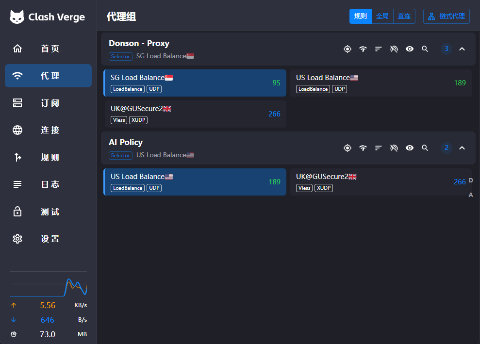

# Kenxu 连接指南

选好设备，按 **安装 → 导入 → 选线路 → 验证** 完成连接。网站「使用文档」提供相同的分设备步骤、导入入口和可勾选的检查项；勾选只记录你的确认，不代表网站已检测本机连接。

Kenxu 面向邀请用户。首次登录请先修改初始密码，后续只使用「我的订阅」中的个人链接，不转发账号、订阅或配置。服务不保证持续可用；遇到问题先按本文排查，再联系 Donson。

## 选择客户端

| 设备 | 客户端 | 本站提供的内容 |
| --- | --- | --- |
| Windows / macOS / Linux | Clash Verge Rev | 授权 YAML、策略组与规则 |
| Android | Clash Meta for Android | 授权 YAML、策略组与规则 |
| iPhone / iPad | Shadowrocket | 授权 VLESS 节点订阅，使用应用自己的路由设置 |
| iPhone / iPad | Stash | 适配后的 iOS YAML，含授权节点、组和域名规则 |

订阅页可手动切换客户端。**先选对客户端，再复制或导入链接**；不同格式的链接不能混用。一键导入只尝试唤起对应应用，仍需你在客户端确认。微信等内置浏览器未能唤起时，改用 Edge / Chrome / Safari，或手动导入。

## 电脑：Clash Verge Rev

### 1. 安装客户端

打开 [Clash Verge Rev 官方最新稳定版](https://github.com/clash-verge-rev/clash-verge-rev/releases/latest)，在 **Assets** 选择安装包。不要下载 Source code，也不必选择 Pre-release 测试版。

| 电脑 | 常见安装包后缀 |
| --- | --- |
| 多数 Windows 电脑 | `x64-setup.exe` |
| Windows ARM 电脑 | `arm64-setup.exe` |
| Apple Silicon Mac（M 系列） | `aarch64.dmg` |
| Intel Mac | `x64.dmg` |
| Linux | 按发行版选 `.deb` / `.rpm`，架构与设备一致 |

版本号、支持架构和最低系统要求以官方发布页为准。GitHub 暂时打不开时稍后重试，或联系 Donson 获取安装帮助，不要安装来源不明的客户端。

### 2. 导入并选中个人订阅

1. 登录 Kenxu，打开「我的订阅」，客户端选择 **Clash Verge**。
2. 点击「一键导入 Clash Verge」，允许浏览器打开应用，在客户端确认导入。
3. 点击新出现的 **Kenxu** 配置卡片，确认处于选中状态。

没有自动打开时，复制本站当前个人链接，到 Clash Verge 左侧「订阅」页面粘贴并导入。优先使用远程订阅，而不是一份不会自动更新的本地 YAML。

### 3. 保持规则模式，选好两个组

进入左侧「代理」，右上角保持 **规则**。日常只需关注：

- **Donson - Proxy → SG Load Balance**：普通代理访问的建议起点。
- **AI Policy → US Load Balance**：命中 AI 规则的请求独立选择线路。

换主代理组不会覆盖 AI 组的选择。其他辅助分流由配置处理，不必手动展开隐藏组；实际可选项以个人授权为准。

这是用户本次提供的电脑界面示例。蓝色卡片表示选中；右侧数字是截图当时客户端测试的响应耗时（毫秒），不是下载速度或实时保证。

| 名称 | 用途 |
| --- | --- |
| `Donson - Proxy` | 一般代理流量的主选择组；配置里的直连和专用分流仍各自生效 |
| `AI Policy` | AI 规则命中的请求单独使用这里的选择 |
| `SG / US Load Balance` | 分别在已授权的新加坡／美国节点间按策略分配连接 |
| `UK@GUSecure2` | 经 SG2 转发到 Glasgow 的英国线路，本站只支持 TCP |

Load Balance 是节点组，不是一台服务器，也不保证带宽相加或始终选最低延迟。策略含义可参考 [Mihomo 负载均衡文档](https://wiki.metacubex.one/en/config/proxy-groups/load-balance/)。

### 4. 开启系统代理，验证实际访问

在客户端「首页」或「设置」开启 **系统代理**，再用浏览器打开目标网站。部分应用不使用系统代理，才需按 [Clash Verge Rev 官方快速入门](https://www.clashverge.dev/guide/quickstart.html) 配置 TUN。

确认这三项：

- Kenxu 配置已选中。
- 规则模式、策略组与系统代理已确认。
- 目标网站实际打开。

连接测试出现数字只是排查线索，不代表所有网站都可访问。先完成浏览器验证，不要一次同时修改多个网络开关。

## Android：Clash Meta for Android

### 1. 安装客户端

从 [官方最新稳定版](https://github.com/MetaCubeX/ClashMetaForAndroid/releases/latest) 的 Assets 下载 APK，避开 Pre-release / alpha。多数现代手机适用 `arm64-v8a-release.apk`；不确定时检查设备信息。

按系统提示允许此次 APK 安装，完成后可关闭浏览器的安装授权。下载或安装受限时联系 Donson，不使用不明来源镜像。

### 2. 导入并保存配置

在本站「我的订阅」选择 **Clash Meta for Android**，点击一键导入，在应用中确认并保存。

手动方式：

1. 复制本站当前个人链接。
2. 应用「配置」→「＋」→「从 URL 导入」。
3. 名称填 **Kenxu**，URL 粘贴完整链接。
4. 自动更新间隔可设为默认建议的 **720 分钟（12 小时）**，然后保存；站点设置调整后以新建议为准。

本站生成的导入协议为 `clashmeta://install-config?url=<已编码链接>`，参考 [Android 项目说明](https://github.com/MetaCubeX/ClashMetaForAndroid)。

### 3. 选中配置，保持规则分流

在「配置」选中 Kenxu，回到首页启动连接。首次请求 VPN 权限时允许，再进入「代理」保持规则模式：

- 普通访问可先选 **Donson - Proxy → SG Load Balance**。
- AI 网站可先选 **AI Policy → US Load Balance**。

前面的电脑截图只用于对照组名，并非 Android 操作截图。实际入口以应用版本为准。

### 4. 验证连接

确认 Kenxu 已选中、VPN 已允许且客户端正在运行，然后实际打开目标网站。VPN 标识和延迟数字不能替代实际访问。

避免另一款 VPN 同时接管网络。锁屏后经常断开时，再按需允许客户端后台运行或调整省电设置；不使用时可以主动停止连接。

## iPhone / iPad

### 1. 用自己的 Apple 账号获取应用

选择自己已购买或适合的客户端：

- [Shadowrocket · App Store](https://apps.apple.com/app/id932747118)：节点订阅，应用自己的路由设置。
- [Stash · App Store](https://apps.apple.com/app/id1596063349)：适配后的 iOS YAML，保留本站组名和域名规则。

可用地区、价格与系统要求以商店为准。无法获取时联系 Donson，不借用陌生人的 Apple 账号，也不在网站提交设备密码。

### 2. 按应用导入对应的个人订阅

在 **Safari** 打开本站「我的订阅」，选择客户端，再点击一键导入并允许打开应用。不要把 Clash YAML 链接直接当作 Shadowrocket 节点订阅。

未唤起应用时：

| 应用 | 手动方式 |
| --- | --- |
| Shadowrocket | 首页「＋」→ 类型选 Subscribe（订阅）→ URL 粘贴该格式的个人链接 → 保存并更新 |
| Stash | 配置管理中从 URL 下载 → 粘贴本站为 Stash 显示的 iOS YAML 链接 → 选中配置 |

微信等内置浏览器中可改用 Safari。不要扫描其他人的共享订阅二维码。

### 3. 按应用选线路

**Shadowrocket：** 从列表选择可用节点，使用应用自己的全局路由设置。节点订阅不包含 Clash 的两个选择组，不要照搬电脑步骤。AI 网站不可用时，可以测试并切换已授权的美国或英国线路，再实际验证。界面操作可参考 [Shadowrocket 社区手册（非官方）](https://github.com/LOWERTOP/Shadowrocket/wiki)。

**Stash：** 选中 Kenxu，保持规则分流。普通访问可先用 Donson - Proxy → SG Load Balance，AI 请求可先用 AI Policy → US Load Balance。辅助组无需手动展开。本站适配保留授权节点、策略组和域名规则，将 `sticky-sessions` 转为 `consistent-hashing`，省略电脑进程规则和电脑 DNS 配置，使用 Stash DNS。

Stash 格式与导入方式依据 [策略组](https://stash.wiki/proxy-protocols/proxy-groups)、[协议说明](https://stash.wiki/proxy-protocols/proxy-types) 和 [URL Schema](https://stash.wiki/faq/url-schema)。教程中的电脑截图仅用于对照组名，不是 Stash 操作截图。

### 4. 允许 VPN，验证实际访问

打开连接开关，按 iOS 提示允许添加 VPN 配置。设备密码或生物识别只在系统提示中由你确认，不要提交给网站。连接后实际打开目标网站。

可按需开启应用的订阅自动更新；iOS 后台更新不一定及时执行，线路调整后手动更新更直接。

## 连接排查

### 已导入，但网站打不开

按顺序排查，尽量一次只改一项：

1. 确认是自己的最新订阅，并已在客户端选中。
2. 电脑开启系统代理；手机允许并启动 VPN。
3. Clash / Stash 使用规则模式；Shadowrocket 检查所选节点和自身路由。
4. 更新订阅、测试可用线路，再实际访问目标网站。切换后仍沿用旧连接时，可关闭对应的客户端连接再重试。

网页显示「正常」来自 Jetson 对源节点的定时检测，默认每 15 分钟一次。你的网络与客户端到入口的路径可能不同，网页刷新也不会立即重新检测节点。

### 只有 AI 网站有问题

先查看本站 **AI 状态** 是否有对应官方故障，再测试自己的线路。Clash / Stash 调整 **AI Policy**，不是主代理组；Shadowrocket 则切换所选节点或检查路由。

没有官方事件、节点检测正常，也不能保证所有地区、个人账号或模型都可用。无需向本站提供 AI 账号、密码或 API 密钥。

### 订阅校验提示 unsupported rule type

如果提示 `PROCESS-PATH-WILDCARD` 或 `PROCESS-NAME-WILDCARD` 不受支持，先在订阅卡片刷新 Kenxu，再重新选中。下载的本地 YAML 需重新下载；本站远程导出已做兼容处理。

若仍出现旧通配符，检查全局覆写、扩展脚本或合并配置，或从官方渠道更新客户端及其配套内核。反馈错误最后一行和版本，不要发送整份配置、密码或订阅链接。

### 仍需帮助

向 Donson 提供客户端版本、所选组或节点、出错时间与提示。截图前遮住订阅链接和密码。不要反复重装或同时修改全部设置。

## 更新订阅与用量

默认建议每 **720 分钟（12 小时）** 更新订阅，以站点最新设置为准。客户端已保存的间隔可能不同，管理员调整线路后可手动刷新。个人规则修改同样要更新订阅才会生效。

远程订阅可获取新配置，并由兼容客户端读取响应头里的本月用量。下载的 YAML 是当时的配置副本，作为本地文件导入不会自动获取后续修改或订阅用量。

网页默认每分钟读取统计；Clash Verge 订阅卡片通常在更新订阅时刷新。左下角的实时速率和本机累计也不是本站账号的本月总量。本站统计受管入口上传与下载合计，不包含直连。

**100 GB 是默认月展示参考，不限流、不停用**；具体展示额度以账户卡片为准。每月 1 日按北京时间重算月视图，累计记录保留。「流量明细」只列最近 30 天实际有用量的日期；趋势图仍保留完整日期，不删除原账本。

## 账号与隐私

- 登录提示尝试过多时，按倒计时等待，不要反复猜测。忘记密码请联系 Donson 重置；新初始密码仍需首次登录修改。
- 订阅链接泄露时，在「我的订阅」重置并重新导入。旧链接会失效，但已下载的节点凭据不会自动改变，必要时同时联系管理员处理。
- 受管线路记录账号用量、实际连接来源 IP、目标域名或 IP 和连接字节，供管理员排查异常用量。使用元数据保留 30 天，不记录网页路径、正文，也不解密 HTTPS。管理员流量去向只用连接实际字节，不用旧分钟区间推算网站消耗。
- 个人中心只在最近使用 IP 后显示国家、省市的归属估算。这是代理入口看到的来源，不是网页登录 IP；共享网络可能共用公网 IP，直连／不计量备用不在记录范围内。用户看不到他人的来源或管理员的目标统计。
- 已缓存归属直接显示；缓存缺失时，仅把最近这一条公网 IP 发给 IPinfo Legacy Free 补查，不发送账号或访问目标。成功缓存 7 天，失败退避 5 分钟，不查询整段历史。归属是估算，不是具体住址；缺失省市不会补造，查询不可用时保留已知离线地区。
